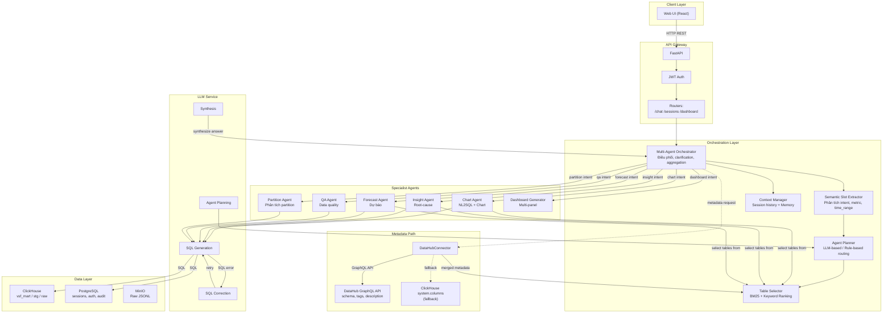
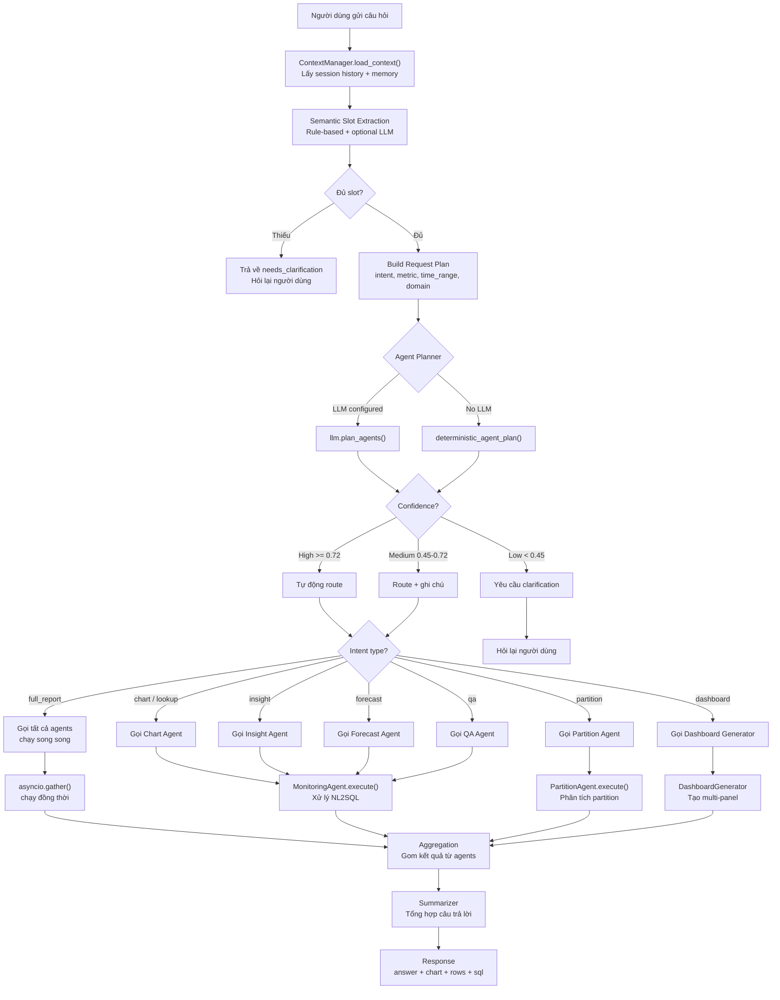
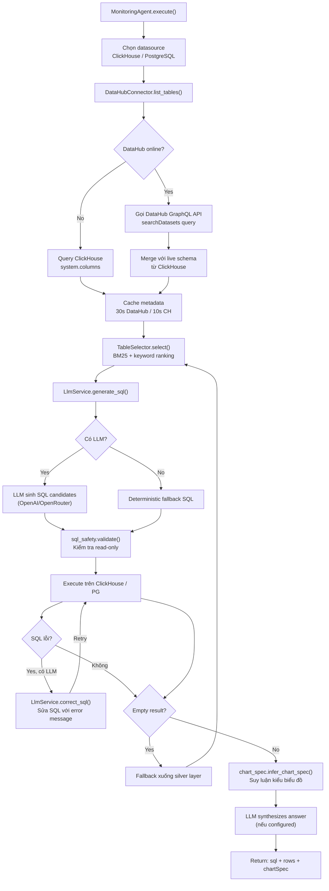
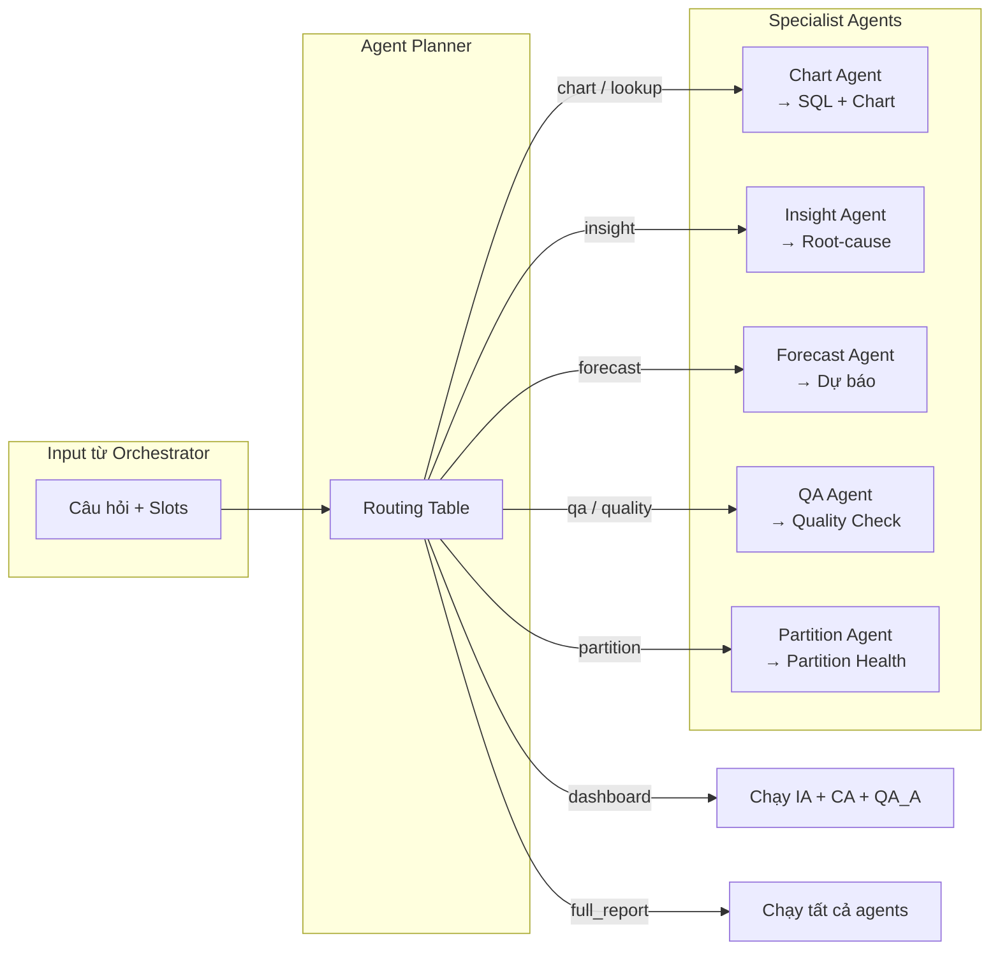
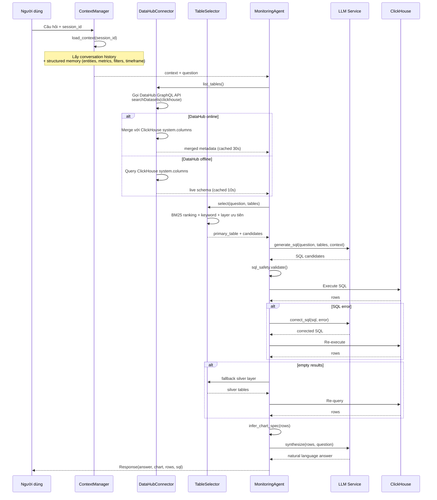
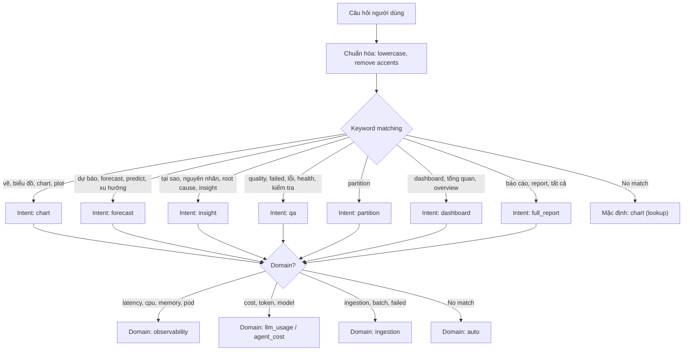
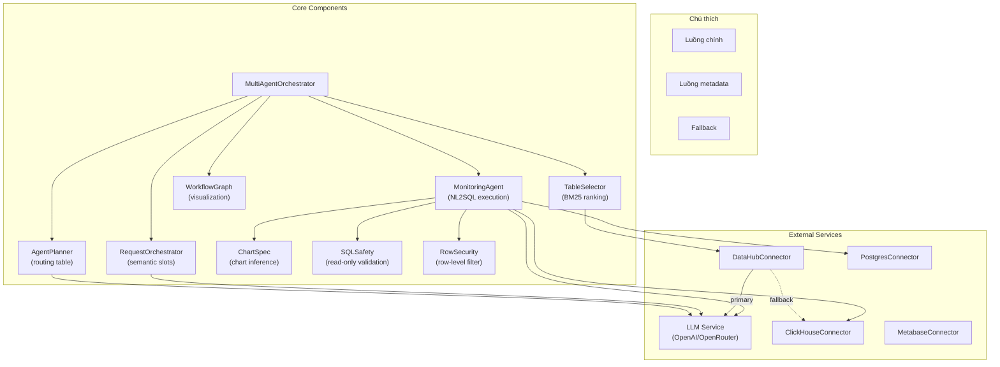

# Agentic BI — Multi-Agent Workflow

## 1. Tổng quan Multi-Agent Architecture



---

## 2. Orchestrator Flow chi tiết



---

## 3. Monitoring Agent Execution Flow



---

## 4. Agent Routing & Planning



---

## 5. Clarification Flow

```mermaid
sequenceDiagram
    actor User as Người dùng
    participant GW as API Gateway
    participant Orchestrator as Orchestrator
    participant SlotExt as Slot Extractor
    participant Planner as Agent Planner

    User->>GW: "Cho tôi xem metric"
    GW->>Orchestrator: ChatRequest(question)
    Orchestrator->>SlotExt: extract_slots()
    
    Note over SlotExt: Phân tích: intent=rõ (chart),<br/>metric=không rõ, time_range=không rõ

    SlotExt-->>Orchestrator: slots: {intent: chart, metric: null, time_range: null}
    
    Orchestrator->>Planner: build_request_plan()
    Note over Planner: Thiếu metric + time_range →<br/>confidence low
    Planner-->>Orchestrator: clarification needed

    Orchestrator-->>GW: needs_clarification
    GW-->>User: {
        "clarification": true,
        "message": "Bạn muốn xem metric nào?",
        "options": ["latency", "errors", "cost", "tokens"]
    }

    User->>GW: "latency 7 ngày qua"
    GW->>Orchestrator: ChatRequest(question, context=previous)
    Orchestrator->>SlotExt: extract_slots(question, context)
    
    Note over SlotExt: Kết hợp câu mới + context cũ<br/>→ intent=chart, metric=latency, time_range=7days
    
    SlotExt-->>Orchestrator: slots: {intent: chart, metric: latency, time_range: 7days}
    Orchestrator->>Planner: build_request_plan() → confidence high
    Planner-->>Orchestrator: agent_plan: [chart_agent]
    
    Orchestrator->>Orchestrator: Gọi Chart Agent với đầy đủ slots
    Orchestrator-->>GW: Response(chart, rows, sql)
    GW-->>User: Kết quả biểu đồ
```

---

## 6. Multi-Agent Data Flow (Context + Metadata)



---

## 7. Intent Classification Rules



---

## 8. Component Interaction Summary



---

## 9. File Structure Reference

```
src/backend/app/
├── main.py                     # FastAPI entrypoint
├── config.py                   # Env-driven settings
├── security.py                 # JWT auth + rate limiting
├── observability.py            # Langfuse + OpenTelemetry
├── sql_guard.py                # Raw SQL validation
├── terminal.py                 # Safe terminal runner
├── agent.py                    # TerminalAgent
│
├── agents/
│   ├── multi_agent.py          # MultiAgentOrchestrator
│   ├── agent_planner.py        # Routing table
│   ├── request_orchestrator.py # Semantic slots
│   ├── table_selector.py       # Table selection
│   ├── monitoring_agent.py     # Main NL2SQL agent
│   ├── partition_agent.py      # Partition analysis
│   ├── partition_manager.py    # Partition health
│   ├── sql_safety.py           # Agent SQL validation
│   ├── row_security.py         # Row-level security
│   ├── chart_spec.py           # Chart inference
│   ├── dashboard_generator.py  # Dashboard generation
│   └── workflow_graph.py       # Workflow visualization
│
├── services/
│   ├── llm.py                  # LLM client
│   └── context_manager.py      # Session + memory
│
├── connectors/
│   ├── clickhouse.py
│   ├── postgres.py
│   ├── datahub.py
│   └── metabase.py
│
└── routers/
    ├── query.py
    ├── sessions.py
    ├── dashboard.py
    └── auth.py
```
