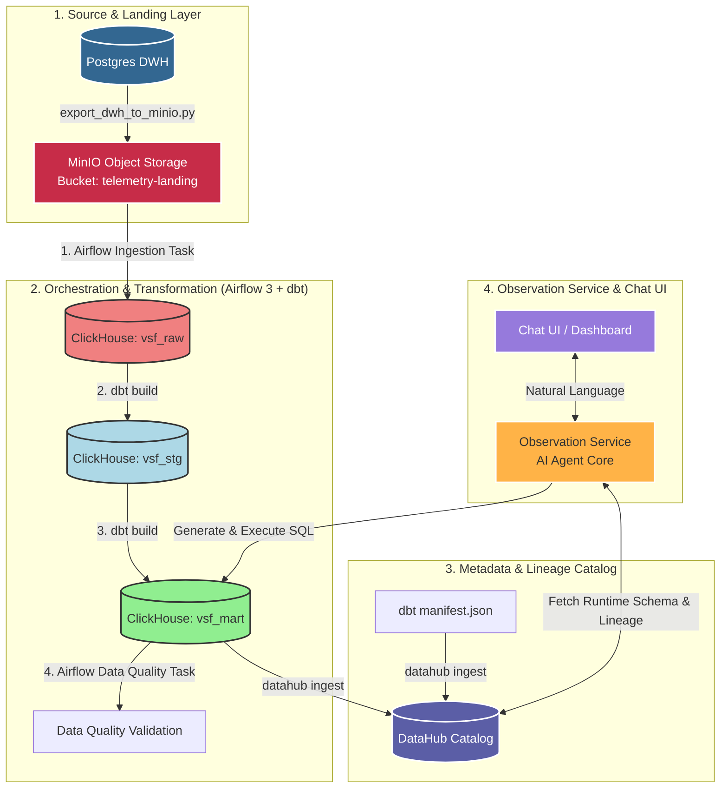

# Tài liệu Kiến trúc Hệ thống Agentic BI & ClickHouse DWH

Dự án **Agentic BI** là một hệ thống đàm thoại phân tích dữ liệu thông minh. Người dùng có thể hỏi các câu hỏi nghiệp vụ bằng ngôn ngữ tự nhiên thông qua giao diện Chat UI, AI Agent sẽ tự động khám phá cấu trúc bảng (schema) và sơ đồ luồng dữ liệu (lineage) từ DataHub, dịch câu hỏi thành câu lệnh Clickhouse SQL, thực thi truy vấn và trực quan hóa kết quả dưới dạng bảng, biểu đồ hoặc dashboard.

Tài liệu này trình bày chi tiết phương án thiết kế CSDL trung tâm (Central Analytics Warehouse) trên VPS sử dụng **ClickHouse** để hợp nhất dữ liệu giám sát và hội thoại từ 4 thành viên trong nhóm.

---

## 1. Sơ đồ luồng dữ liệu tổng quan

Dữ liệu từ các local stack của từng thành viên sẽ được gom về VPS thông qua luồng tự động:



---

## 2. Bảng so sánh kiểu dữ liệu (Postgres vs ClickHouse)

Để tối ưu hóa hiệu năng lưu trữ columnar và tốc độ truy vấn của ClickHouse, các kiểu dữ liệu của PostgreSQL đã được chuyển đổi tương ứng:

| Tên Bảng & Cột | Kiểu Cũ (PostgreSQL) | Kiểu Mới (ClickHouse) | Vai trò & Quy tắc chuyển đổi |
| :--- | :--- | :--- | :--- |
| **`vsf_mart.source_apps`** | | | *Danh mục ứng dụng nguồn (dbt seed)* |
| `source_app_id` | `text` (PK) | `String` | ID duy nhất định danh app của từng thành viên. |
| `domain` | `text` | `String` | Nghiệp vụ ứng dụng (`healthcare`, `finance`...). |
| `environment` | `text` | `String` | Môi trường (`dev`, `staging`, `prod`). |
| `is_active` | `boolean` | `UInt8` hoặc `Bool` | Cờ trạng thái hoạt động (1: Active, 0: Inactive). |
| **`vsf_raw.raw_ingestion_batches`** | | | *Log lịch sử nạp dữ liệu từ MinIO* |
| `batch_id` | `uuid` (PK) | `UUID` | ID ngẫu nhiên định danh phiên nạp file. |
| `object_path` | `text` | `Nullable(String)` | Đường dẫn file trên MinIO (`s3://...`). |
| `row_count` | `bigint` | `Int64` | Số lượng dòng dữ liệu thô nạp thành công. |
| `status` | `text` | `String` | Trạng thái batch (`running`, `success`, `failed`). |
| **`vsf_stg.staging_llm_generations`** | | | *Tầng Silver chuẩn hóa dữ liệu sinh LLM* |
| `generation_id` | `text` | `String` | ID lượt sinh LLM (Từ Langfuse). |
| `source_app_id` | `text` | `String` | Liên kết ngược về ứng dụng nguồn. |
| `provider` | `text` | `String` | Hãng cung cấp mô hình (tự động phân loại từ tên model). |
| `total_cost_usd` | `numeric(18,8)`| `Decimal(18, 8)` | Tổng chi phí lượt gọi bằng USD. |
| `user_id_hash` | `text` | `Nullable(String)` | Băm mã hóa user_id để bảo mật (GDPR/PII). |
| **`vsf_mart.gold_app_daily_cost`** | | | *Tầng Gold tổng hợp dữ liệu phân tích* |
| `date` | `date` | `Date` | Ngày tổng hợp dữ liệu. |
| `request_count` | `bigint` | `Int64` | Tổng số request LLM trong ngày. |
| `p95_latency_ms` | `numeric` | `Float64` | Thời gian phản hồi phân vị 95 (độ trễ lớn nhất). |

---

## 3. Scripts khởi tạo DDL ClickHouse (Bronze, Silver, Gold)

### Tầng 0: Khởi tạo các Cơ sở dữ liệu (Databases)
```sql
CREATE DATABASE IF NOT EXISTS vsf_raw;   -- Bronze Layer: Chứa dữ liệu thô thô đầu vào
CREATE DATABASE IF NOT EXISTS vsf_stg;   -- Silver Layer: Dữ liệu đã làm sạch & chuẩn hóa
CREATE DATABASE IF NOT EXISTS vsf_mart;  -- Gold Layer: Bảng phục vụ trực tiếp BI/Agent
```

### Tầng 1: Lớp `vsf_raw` (Bronze Layer)
```sql
-- Bảng quản lý đợt nạp dữ liệu từ MinIO
CREATE TABLE IF NOT EXISTS vsf_raw.raw_ingestion_batches (
    batch_id UUID,                                     -- ID duy nhất của lô tải
    source_app_id String,                              -- ID ứng dụng gửi
    source_table String,                               -- Bảng thô đích
    object_path Nullable(String),                      -- Link file thô trên MinIO
    extract_started_at Nullable(DateTime64(6, 'UTC')), -- Bắt đầu kết xuất local
    extract_finished_at Nullable(DateTime64(6, 'UTC')),-- Kết thúc kết xuất local
    load_started_at Nullable(DateTime64(6, 'UTC')),    -- Bắt đầu load lên VPS
    load_finished_at Nullable(DateTime64(6, 'UTC')),   -- Kết thúc load lên VPS
    row_count Int64,                                   -- Số lượng dòng nạp thành công
    status String,                                     -- running, success, failed
    error_message Nullable(String),                    -- Chi tiết lỗi nếu bị fail
    created_at DateTime64(6, 'UTC')                    -- Thời điểm ghi log
) ENGINE = ReplacingMergeTree()
ORDER BY (created_at, batch_id);

-- Bảng thô lưu trữ thông tin LLM Generations từ Langfuse
CREATE TABLE IF NOT EXISTS vsf_raw.langfuse_generations (
    generation_id String,
    trace_id String,
    timestamp DateTime64(6, 'UTC'),
    model String,
    prompt_text String,
    response_text String,
    input_tokens Int32,
    output_tokens Int32,
    total_tokens Int32,
    estimated_cost_usd Decimal(12, 6),
    duration_ms Int64,
    status String,
    raw_payload String,
    
    -- Các trường metadata phục vụ phân biệt đa nguồn dữ liệu (Multi-tenancy)
    source_app_id String,              -- ID xác định app/member nào sở hữu bản ghi
    batch_id UUID,                     -- ID batch nạp liên kết
    ingested_at DateTime64(6, 'UTC')   -- Thời gian lưu vào ClickHouse
) ENGINE = ReplacingMergeTree()
ORDER BY (timestamp, source_app_id, generation_id);
```

### Tầng 2: Lớp `vsf_stg` (Silver Layer)
```sql
-- Bảng chuẩn hóa thông tin thế hệ LLM
CREATE TABLE IF NOT EXISTS vsf_stg.staging_llm_generations (
    generation_id String,
    trace_id String,
    source_app_id String,
    domain Nullable(String),       -- Lĩnh vực nghiệp vụ (Healthcare/Finance...) được JOIN làm giàu
    environment Nullable(String),  -- Môi trường chạy (Dev/Prod) được JOIN làm giàu
    user_id_hash Nullable(String), -- ID user băm bảo mật (PII Compliance)
    session_id Nullable(String),
    model String,
    provider String,               -- Nhà cung cấp model (OpenAI, Google...)
    prompt_tokens Int32,
    completion_tokens Int32,
    total_tokens Int32,
    input_cost_usd Decimal(18, 8), -- Chi phí đầu vào tính toán chính xác
    output_cost_usd Decimal(18, 8),-- Chi phí đầu ra tính toán chính xác
    total_cost_usd Decimal(18, 8), -- Tổng chi phí (USD)
    latency_ms Int32,
    status String,
    error_type Nullable(String),
    started_at DateTime64(6, 'UTC'),
    ended_at DateTime64(6, 'UTC'),
    batch_id UUID,
    loaded_at DateTime64(6, 'UTC')
) ENGINE = ReplacingMergeTree()
ORDER BY (source_app_id, generation_id);
```

### Tầng 3: Lớp `vsf_mart` (Gold Layer)
```sql
-- Danh mục thông tin ứng dụng nguồn (Quản lý qua dbt seed)
CREATE TABLE IF NOT EXISTS vsf_mart.source_apps (
    source_app_id String,
    source_app_name String,
    domain String,
    environment String,
    owner_team String,
    source_dwh_type String,
    source_dwh_name String,
    is_active UInt8,
    created_at DateTime64(6, 'UTC'),
    updated_at DateTime64(6, 'UTC')
) ENGINE = ReplacingMergeTree()
ORDER BY source_app_id;

-- Bảng tổng hợp chi phí và chất lượng cuộc gọi LLM hàng ngày
CREATE TABLE IF NOT EXISTS vsf_mart.gold_app_daily_cost (
    date Date,
    source_app_id String,
    domain Nullable(String),
    environment Nullable(String),
    provider String,
    model String,
    request_count Int64,
    total_tokens Int64,
    total_cost_usd Decimal(18, 8),
    avg_latency_ms Float64,
    p95_latency_ms Float64,
    error_count Int64,
    error_rate Float64
) ENGINE = ReplacingMergeTree()
ORDER BY (date, source_app_id, provider, model);
```

---

## 4. Giá trị kỹ thuật & Tối ưu hóa đạt được

1.  **Hiệu năng vượt trội của Columnar DB (ClickHouse):** Tách biệt và tối ưu hóa các kiểu dữ liệu của Postgres sang ClickHouse giúp hệ thống truy vấn tổng hợp trên lượng log khổng lồ cực nhanh mà không bị nghẽn CPU.
2.  **Độ tin cậy nhờ cơ chế Idempotent (`ReplacingMergeTree`):** Đảm bảo ClickHouse tự động loại bỏ trùng lặp khi Airflow chạy lại hoặc bị gián đoạn truyền tải dữ liệu.
3.  **Tự động làm giàu dữ liệu để AI Agent thông minh hơn:**
    *   **Domain & Environment:** Giúp AI Agent tự động hiểu ngữ cảnh nghiệp vụ để sinh SQL so sánh chi phí chéo giữa các lĩnh vực, hoặc tự động giới hạn phạm vi dữ liệu (`WHERE domain = '...'`) theo quyền hạn người dùng.
    *   **Provider & Costs:** Chuẩn hóa thông tin để đưa ra các phân tích tối ưu hóa chi phí giữa các nhà cung cấp mô hình (OpenAI, Gemini...).
    *   **Bảo mật:** Mã hóa thông tin nhạy cảm của người dùng (`user_id_hash`) trước khi đưa vào kho lưu trữ tập trung.
4.  **Khả năng Audit luồng Ingestion:** Quản lý rõ ràng trạng thái gửi nhận qua `batch_id`, giúp cô lập và dễ dàng rollback xử lý khi có lỗi xảy ra ở bất cứ local stack nào của thành viên.

---

## 5. Danh mục bảng đầy đủ trong Central DWH

| Tầng DWH | Database | Bảng (Table) | Nội dung / Vai trò |
| :--- | :--- | :--- | :--- |
| **Bronze (Raw)** | `vsf_raw` | `raw_ingestion_batches` | Nhật ký các lô dữ liệu đã nạp |
| | | `langfuse_generations` | Nhật ký thô sinh nội dung của LLM |
| | | `user_interactions` | Hội thoại tương tác người dùng |
| | | `signoz_logs`, `signoz_traces`, `signoz_metrics` | Logs, traces, metrics thô từ SigNoz APM |
| **Silver (Staging)** | `vsf_stg` | `staging_llm_generations` | Dữ liệu Langfuse chuẩn hóa kiểu & khử trùng |
| | | `stg_signoz_logs`, `stg_user_interactions` | Staging tables làm sạch phục vụ Gold |
| **Gold (Mart)** | `vsf_mart` | `source_apps` | Danh mục ứng dụng nguồn (dbt seed) |
| | | `fct_llm_interactions` | Bảng Fact chính làm giàu thông tin lỗi & tokens |
| | | `gold_app_daily_cost` | Bảng tổng hợp chi phí và latency hàng ngày |
| | | `data_quality_results` | Nhật ký lưu lịch sử kết quả kiểm tra chất lượng dữ liệu |
