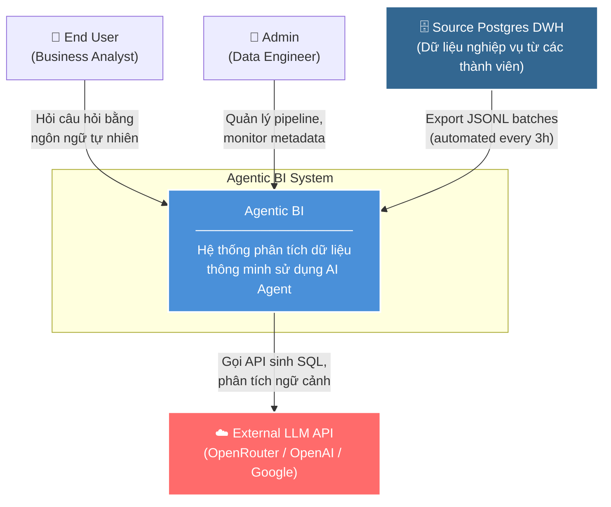
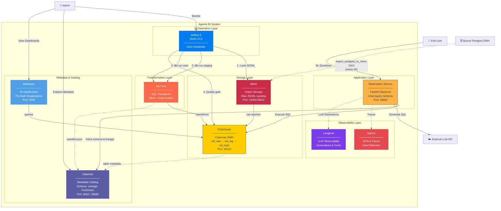
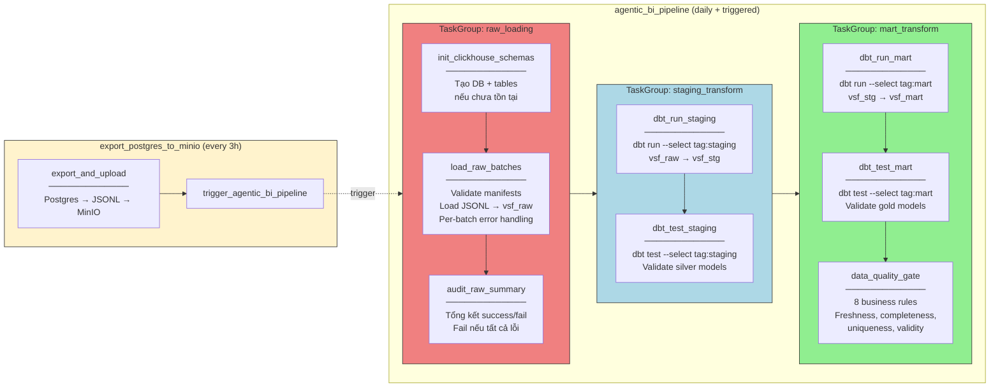
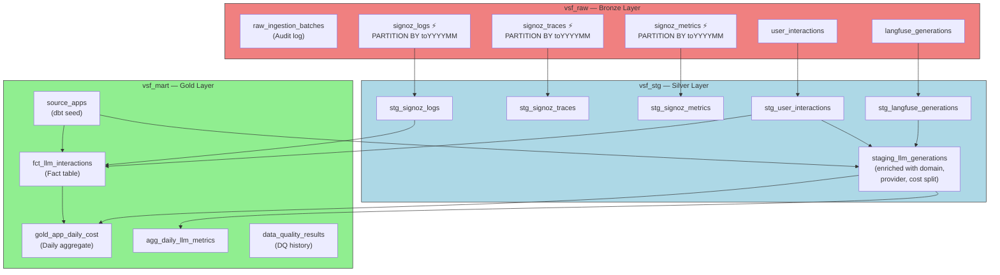
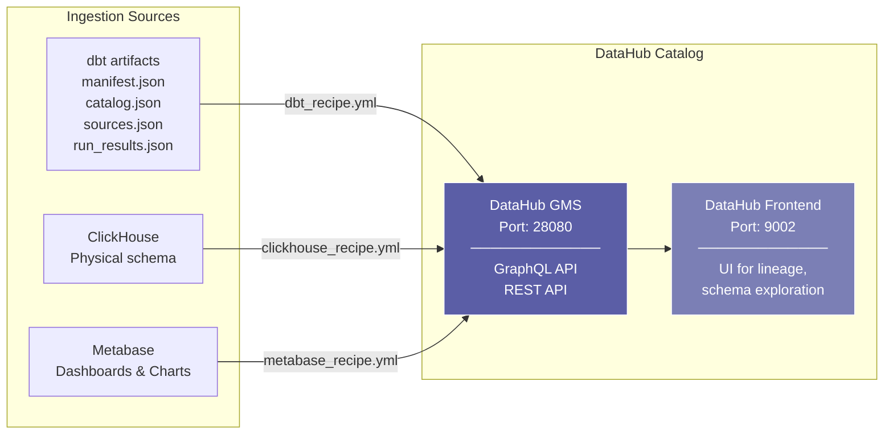

# C4 Architecture — Agentic BI System

Tài liệu kiến trúc theo chuẩn [C4 Model](https://c4model.com) cho hệ thống Agentic BI.

---

## Level 1 — System Context Diagram

Hệ thống Agentic BI trong bối cảnh tương tác với người dùng và hệ thống bên ngoài.

---

## Level 2 — Container Diagram

Chi tiết các container (services) bên trong hệ thống.

---

## Level 3 — Component Diagram: Airflow Pipeline

Chi tiết các task groups bên trong DAG `agentic_bi_pipeline`.

---

## Level 3 — Component Diagram: Data Warehouse Layers

---

## Level 3 — Component Diagram: Metadata Ingestion

---

## Deployment Topology

| Container | Image | Port | Network |
|:---|:---|:---|:---|
| `agentic_clickhouse` | `clickhouse-server:24.8-alpine` | 18123, 19000 | airflow |
| `minio` | `minio/minio` | 19001, 19002 | airflow |
| `agentic_observation_service` | Custom (FastAPI) | 18000 | airflow |
| Airflow Scheduler | Astro CLI managed | 18080 | airflow |
| Airflow Webserver | Astro CLI managed | - | airflow |
| DataHub GMS | DataHub stack | 28080 | datahub |
| DataHub Frontend | DataHub stack | 9002 | datahub |
| Metabase | `metabase/metabase` | 3000 | airflow |

---

## Key Design Decisions

1. **ClickHouse over PostgreSQL for analytics**: Columnar storage provides 10-100x faster aggregation queries on telemetry data.
2. **MinIO as landing zone**: Decouples data producers from the warehouse. JSONL+manifest pattern enables idempotent re-processing.
3. **DataHub over OpenMetadata**: Better dbt and ClickHouse connector support, mature GraphQL API for agent runtime queries.
4. **Astro CLI for Airflow**: Simplifies local development with Docker-based runtime, built-in scheduler/webserver management.
5. **ReplacingMergeTree engine**: Provides eventual deduplication for idempotent batch loads without manual UPSERT logic.
6. **Per-batch error handling**: Pipeline resilience — individual batch failures don't block the entire data refresh.
