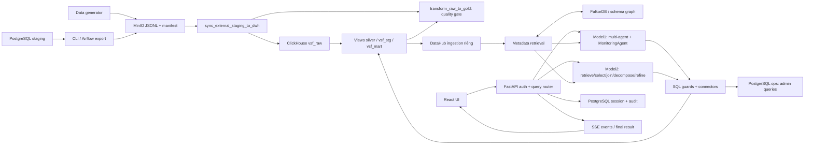

# Kế hoạch refactor core functions — Agentic BI

Ngày khảo sát: 2026-09-06. Trạng thái: đề xuất triển khai, chưa sửa runtime.

Đề xuất chính: giữ `model1` và `model2` như hai chiến lược xử lý khác nhau, đưa các phần dùng chung về những module có trách nhiệm rõ ràng: hợp đồng dữ liệu, SQL policy/execution, metadata, request lifecycle và LLM transport. Refactor theo từng đường chạy có test bảo vệ, đồng thời xử lý độ lệch giữa ingestion, schema và runbook.

## 1. Phạm vi và bằng chứng khảo sát

Đã khảo sát backend/API, hai luồng agent, specialists, metadata/MCP/graph, auth/session/audit, frontend, DAG/export, SQL khởi tạo/migration, Compose/start/verify và test/evaluation. Phân tích AST toàn bộ Python trong các thư mục nguồn và test liệt kê dưới đây; đọc sâu các entrypoint và nhánh core. Đây là khảo sát mã nguồn và test cục bộ, chưa xác minh hệ thống đang chạy trên server.

| Khu vực | Quy mô Python hiện tại | Trách nhiệm |
|---|---:|---|
| `src/backend/app` | 63 file, 21.173 dòng | API, agent, connectors, bảo mật, session |
| `metadata` | 7 file, 751 dòng | DataHub client, parsing, MCP, freshness |
| `dags` | 4 file, 955 dòng | Export, ingestion, quality, data generator |
| `scripts` | 6 file Python, 1.847 dòng | Seed, export, inspect, verify |
| `include/scripts` | 1 file, 580 dòng | Bản sao data generator dùng trong Airflow |
| `tests` + `src/backend/tests` | 31 file Python, 4.384 dòng | Unit/static contracts, DAG test, evaluation runners |

Không tính dependency, cache và artifact sinh tự động vào quy mô nguồn. Frontend và cấu hình triển khai được khảo sát riêng, không nằm trong thống kê Python.

Workspace đã có thay đổi chưa commit ở metadata, query router, test và một số file bị xóa. Kế hoạch dựa trên working tree này; các thay đổi đó không phải kết quả của lượt khảo sát. Tiếp tục hướng tách `metadata/client/parsing.py` hiện có, không khôi phục các module đã xóa chỉ để làm sạch import/test.

### Baseline kiểm chứng

- AST parse thành công với các file Python trong bảng.
- Test tổng, sau khi tắt plugin tự nạp: **12 lỗi collection**, chủ yếu thiếu `psycopg`, `bcrypt`; test parser DAG kéo theo Airflow cần `fcntl` trên Windows.
- Lần chạy mặc định còn bị plugin OpenMetadata trong môi trường Python gây lỗi `metadata.generated`. Đây là vấn đề môi trường/dependency, chưa phải kết luận runtime backend hỏng.
- Tập chạy độc lập: **84 passed, 1 failed**. Failure: `tests/test_task9_cleanup.py::test_dbt_directory_removed`; `include/dbt_project` vẫn chứa `logs`, `target`, `.user.yml`.
- Chưa chạy frontend build vì chưa có `src/frontend/node_modules`; chưa build Docker hay gọi LLM/DataHub/warehouse thật.
- `tests/evaluation_report.md` là kết quả lịch sử ngày 2026-06-25, không dùng tỷ lệ trong đó làm chất lượng hiện tại. Có sẵn `golden_set.json` và runner so sánh hai model để xây baseline mới.

Lệnh tái lập tập test độc lập trên PowerShell:

```powershell
$env:PYTHONPATH = 'D:\agentic-bi-personal\src\backend;D:\agentic-bi-personal'
$env:PYTHONDONTWRITEBYTECODE = '1'
$env:PYTHONUTF8 = '1'
$env:PYTEST_DISABLE_PLUGIN_AUTOLOAD = '1'
.\venv\Scripts\python.exe -m pytest tests --ignore=tests/dags --ignore=tests/test_task2_parse_path.py src/backend/tests/test_datahub_connector.py src/backend/tests/test_query_decomposer.py --disable-warnings --tb=short
```

## 2. Bản đồ hệ thống hiện tại



Các điểm cần giữ đúng khi refactor:

- `/chat` hiện là alias BI chat nhận `ChatRequest.question`. Terminal chat hiện ở `/api/terminal/chat`; mô tả cũ trong backend README chưa phản ánh thay đổi này.
- `model1`: semantic slots → agent plan → specialists chạy đồng thời → tổng hợp. `chart_agent` gọi `MonitoringAgent`, bên trong lại phân loại và lập request plan.
- `model2`: request/relevancy → catalog/graph retrieval → pruning → join planning → decomposition → candidates/refinement → formatting → lưu query plan.
- Model1 chấm điểm nhiều candidate chạy được; Model2 chọn candidate chạy thành công đầu tiên. Đây là khác biệt chiến lược cần giữ khi tách executor.
- Dashboard tự sinh hiện gọi trực tiếp `MonitoringAgent`; trường `model` kế thừa từ `ChatRequest` chưa được router dashboard sử dụng.
- Transformation hiện dựa vào ClickHouse views; vẫn có schema `silver` trong SQL và dấu vết dbt trong runbook/metadata scripts. Chưa thể coi mọi runtime path đã thống nhất `vsf_stg`.

## 3. Các vấn đề ưu tiên

P0: ảnh hưởng khả năng khởi động, kiểm soát truy vấn hoặc tính đúng đắn của luồng. P1: ảnh hưởng bảo trì, latency và quan sát lỗi. P2: tinh gọn sau khi ổn định hành vi.

| ID | Ưu tiên | Bằng chứng trong mã | Hệ quả và hướng xử lý |
|---|---|---|---|
| F01 | P0 | `connectors/datahub.py:11` import `metadata.client.parsing`; `src/backend/Dockerfile:17` chỉ COPY package `app` | Package dùng chung chưa được đóng gói vào image. Mount repo ở `/workspace` không tự thêm vào Python import path. Cần clean-image import smoke; đây là suy luận từ build config, chưa tái hiện bằng Docker build. |
| F02 | P0 | `agents/sql_safety.py:19`, `monitoring_agent.py:793`, `routers/query.py:611`, `row_security.py:17` | Policy phân tán; API trực tiếp không gọi known-table validator như agent. LIMIT chỉ được thêm nếu không thấy từ khóa ở bất cứ đâu. Gom về policy theo SQL AST và dialect. |
| F03 | P0 | `row_security.py:47` bỏ qua bảng không có trong catalog; cuối hàm chỉ chặn khi không match bảng nào | Truy vấn trộn bảng biết/không biết cần bị từ chối rõ ràng; phân biệt CTE với physical table. Predicate thêm vào WHERE của JOIN cũng cần kiểm chứng giữ ngữ nghĩa outer join. |
| F04 | P0 | `routers/query.py:439`: producer chỉ catch `agent.answer`; persist/audit nằm ngoài khối đó | Nếu persistence/audit ném lỗi, producer kết thúc trước final/sentinel; consumer tiếp tục keepalive. Cần lifecycle bảo đảm terminal event và thu hồi task. |
| F05 | P0 | `scripts/export_dwh_to_minio.py:94` dùng `TABLE_TARGET_MAP`, không ghi manifest; DAG exporter ghi manifest với source-table path; loader chỉ scan manifest | Hai entrypoint export không tạo cùng contract. CLI có thể upload dữ liệu mà ingestion không phát hiện. Dùng chung exporter/path/manifest contract. |
| F06 | P1 | `MonitoringAgent.answer`: 724 dòng; `HybridText2SQLOrchestrator.answer`: 323 dòng; `specialist_utils.py`: 1.495 dòng | Trộn routing, SQL, I/O, retry, scoring, rendering và usage. Tách theo trách nhiệm có input/output, tránh chuyển cả khối lớn sang một file utils mới. |
| F07 | P1 | Model2 import `_intent`, `_prepare_sql_candidate` từ Model1; `PartitionAgent.run` import ngược từ `multi_agent` | Phụ thuộc vào private implementation và import vòng. Đưa contracts/policy ra ngoài orchestrator; dùng protocol cho strategy/specialist. |
| F08 | P1 | AST xác nhận 4 cặp hàm trùng giữa monitoring/table selector: `_semantic_domain_column_score`, `_semantic_domain`, `_asks_log_error_detail`, `_asks_latency_root_cause` | Một thay đổi nghiệp vụ dễ làm hai đường chạy lệch nhau. Tập trung lexical rules/metric vocabulary; giữ ranking strategy riêng. |
| F09 | P1 | `LlmService`: 1.337 dòng; transport, prompt, parser và cost nằm cùng lớp; `_request_stream:1131` truy cập `choices[0]` | Cần fixture cho chunk usage có `choices=[]`, JSON hỏng, stream ngắt sau delta. Tách provider transport, task prompts và output parsers. |
| F10 | P1 | Model2 `_merge_usage` chỉ nhận plan + synthesis; Model1 cũng không tổng hợp đủ mọi call planning/classification; thời gian trong SQL agents chốt trước synthesis | Token/cost và latency chưa có cùng định nghĩa giữa các lớp. Dùng ledger theo request cho mọi LLM attempt, total duration chốt tại lifecycle. |
| F11 | P1 | `SummarizerAgent.last_usage` là mutable state trên instance dùng chung; `main.py` khởi tạo dependency ở module scope | Request đồng thời có thể ghi đè usage. Trả usage cùng kết quả, inject dependency qua app factory/lifespan, quản lý shutdown. |
| F12 | P1 | `DataHubConnector.list_tables:43` cache list mutable + `_last_source`; `source_name` luôn `datahub`; graph/lineage có client riêng | Nhãn provenance có thể không phản ánh fallback; chưa có snapshot thống nhất. Phân biệt nguồn schema thật, enrichment và trạng thái degraded. |
| F13 | P1 | ClickHouse tạo HTTP client mỗi query; PostgreSQL mở connection mỗi thao tác; `describe_tables` ClickHouse dùng query có `max_result_rows=500` | Không tái sử dụng pool; catalog lớn có thể bị cắt ở giới hạn dành cho kết quả người dùng. Tách metadata scan và query execution, đóng client trong lifespan. |
| F14 | P1 | `Settings` lấy env ở khai báo class; `query_timeout_seconds` chỉ thấy khai báo, không thấy consumer | Cấu hình khó cô lập trong test; timeout cấu hình chung chưa thành request deadline. Tạo settings tại startup, validate và phân biệt timeout từng call/tổng request. |
| F15 | P1 | `QueryConsolePanel.tsx`: 1.450 dòng; `ObserveChatPanel.tsx`: 793 dòng; hai parser SSE gần như giống nhau | Logic session, stream, usage và chart lặp lại; phần API trả `Record<string, unknown>`. Tách SSE client + hook/reducer + contracts chung. |
| F16 | P1 | Loader đọc toàn object thành string/list rồi tạo thêm list rows; scan toàn bộ manifest và DELETE/INSERT lại mỗi lần | Bộ nhớ tăng theo batch; replay và partial failure cần bằng chứng idempotency. Tách ingestion core, chunked I/O, ledger/checkpoint và kiểm thử replay. |
| F17 | P1 | DAG bỏ dbt, nhưng `metadata/scripts/run-ingestion.*` vẫn chạy dbt; `verify_system.py:223` vẫn bắt buộc artifact dbt | Runbook/verification không chứng minh đúng runtime views. Cập nhật đường metadata và freshness/lineage theo schema thực tế. |
| F18 | P1 | `init_agentic_ui.sql:1` có `DROP DATABASE`; migration partition DROP/CREATE raw tables; init và migration chọn partition ngày/tháng khác nhau | Tách bootstrap với migration có version, bảo toàn dữ liệu và kiểm tra tương thích. Không đưa các file này vào bước chạy tự động trong lượt lập plan. |
| F19 | P2 | Hash trùng hoàn toàn giữa hai data generator và hai SQL schema PostgreSQL | Chọn một nguồn, entrypoint còn lại là wrapper hoặc artifact build được kiểm tra hash. |

F02 đã được tái hiện bằng gọi hàm cục bộ, không query database:

| Input, với `limit=10` | Kết quả hiện tại |
|---|---|
| `SELECT 1 LIMIT 999999` | Giữ nguyên LIMIT lớn |
| `SELECT * FROM (SELECT 1 LIMIT 1) AS t` | Không thêm outer LIMIT |
| `SELECT 'DROP' AS message` | Bị chặn do từ khóa trong string literal |
| `SELECT 'a%20b' AS message` | Literal bị đổi thành `a b` do URL decode |

ClickHouse vẫn có giới hạn phía connector và PostgreSQL có read-only transaction/statement timeout. Các bằng chứng trên phản ánh thiếu nhất quán ở tầng policy, không đồng nghĩa mọi query đều không có bảo vệ.

## 4. Kiến trúc đích và core functions

Giữ monolith hiện có; chỉ tạo module khi đã có caller cần dùng. Không thay framework agent hoặc thay cả hệ thống chart trong cùng đợt.

```text
src/backend/app/
  main.py                      # create_app + lifespan + đăng ký router
  core/
    contracts.py               # RequestContext, QueryPlan, QueryResult, AgentEvent
    errors.py                  # PolicyBlocked, QueryFailed, UpstreamUnavailable...
    ports.py                   # QueryExecutor, MetadataCatalog, AgentStrategy
  services/
    query_service.py           # lifecycle chung cho chat/stream
    sql_policy.py              # AST validation, table access, row policy, limits
    query_execution.py         # candidate execution, attempt record, deadline
    metadata_catalog.py        # snapshot, provenance, fallback, permission filter
    request_planning.py        # context + semantic slots; mỗi request lập một lần
    session_service.py         # session ownership, persist, conflict handling
    result_composer.py         # wire response, chart, evidence; không query DB
    llm/                       # transport, task prompts/parsers, usage
  agents/
    model1/                    # routing specialists, candidate scoring strategy
    model2/                    # graph, joins, decomposition, refinement strategy
    specialists/               # insight, forecast, QA, partition; xử lý chuyên môn
    semantics/                 # vocabulary, normalization, deterministic SQL intent
  connectors/                  # HTTP/SQL/graph adapters; không quyết định agent route
  repositories/                # sessions, audit, users qua PostgreSQL adapter
  routers/                    # HTTP parse/auth/context và serialize
```

Tên/path trên là đề xuất. `services/result_composer.py` mới có phạm vi dựng response chung; không phải khôi phục `model2/result_composer.py` đã bị xóa.

| Core function / contract đề xuất | Input → Output | Phần thay thế/tách ra |
|---|---|---|
| `build_request_context()` | principal + payload + session → RequestContext | `_resolve_session`, question contextualization, queryId/deadline |
| `plan_request()` | question + memory → RequestPlan | Phân loại lặp ở orchestrator/MonitoringAgent/specialists |
| `get_catalog_snapshot()` | datasource + access scope + refresh → CatalogSnapshot | Catalog fetch, normalize, merge, cache/fallback rải rác |
| `prepare_query()` | SQL + dialect + snapshot + principal + limits → PreparedQuery | SQL safety, known tables, row security, table extraction |
| `execute_candidates()` | prepared candidates + selection/repair policy + context → ExecutionResult | Candidate/retry loops hai model; giữ chiến lược chọn winner |
| `compose_result()` | execution + evidence + chart + usage → QueryResult | Dictionary response và usage merge lặp lại |
| `finalize_request()` | context + result → persisted/final outcome | Persist turn, audit, duration và terminal status |
| `stream_events()` | lifecycle task → AgentEvent stream | Queue producer/consumer hiện trong router |
| `export_batch()` / `load_batch()` | manifest contract + adapters → BatchResult | CLI/DAG exporter và loader hiện tại |

Quy tắc phụ thuộc: router → service → contracts/ports; adapter triển khai ports. Domain/semantic code không import FastAPI, Airflow hoặc connector thật. Hai model không import private helper của nhau.

### Hợp đồng cần chốt trước khi di chuyển code

- `RequestContext`: query/session/turn ID, principal bắt buộc, model, datasource, snapshot version, deadline, cancellation, usage ledger. System principal chỉ tạo ở entrypoint nội bộ được chỉ định.
- `QueryResult`: status, answer, rows, row count, SQL, actual used tables, searched tables, attempts, warnings, chart, usage và timing. Giữ camelCase hiện tại ở wire adapter; chưa đổi toàn bộ JSON một lần.
- `AgentEvent`: phân biệt rõ `stage`, `sql`, `delta`, `final`; terminal outcome của v1 nằm trong đúng một `final`. Lỗi trước khi mở stream dùng HTTP status; lỗi sau khi mở stream dùng final status/error có cấu trúc.
- `CatalogSnapshot`: cấu trúc table/column/tag duy nhất; schema nguồn live và DataHub enrichment có provenance riêng; graph cache phải kiểm tra snapshot trước khi dùng lại.
- `QueryAttempt`: loại lỗi policy/SQL/transient/deadline/cancel; policy rejection không đưa vào vòng sửa SQL bằng LLM. Mỗi SQL sửa lại phải đi qua policy đầy đủ.
- Candidate budget, số vòng correction và LLM transport retries là ba khái niệm khác nhau; có trần tổng attempts/deadline để tránh nhân số lần gọi. `includeSynthesis=False` áp dụng cả specialist summarizer và dashboard.
- Metadata/system introspection có quyền và giới hạn riêng; không dùng chung row cap của result người dùng. DQ tổng hệ thống và partition stats cần policy rõ ràng, không bỏ `principal` âm thầm.

## 5. Thứ tự triển khai theo PR

Ước lượng dưới đây là ngày công kỹ thuật, chưa bao gồm thời gian chờ môi trường và đánh giá nghiệp vụ. Chốt lại sau PR-00; không coi đây là cam kết lịch phát hành.

| PR | Ưu tiên | Nội dung và file chính | Phụ thuộc | Ước lượng | Điều kiện hoàn tất |
|---|---|---|---|---:|---|
| 00 | P0 | Chuẩn hóa test env/package path, Docker COPY shared metadata, baseline API/SSE fixtures, cập nhật danh sách test legacy | — | 1–2 | Clean image import được backend/shared package; unit suite reproducible; mỗi failure cũ có phân loại, không xóa test để che lỗi |
| 01 | P1 | Contracts/ports và app factory/lifespan; tách dependency construction khỏi `main.py`, router factory | 00 | 1–2 | Test tạo hai app với settings riêng; không kết nối DB khi chỉ import domain; client đóng đúng khi shutdown |
| 02 | P0 | SQL AST policy và execution boundary dùng chung: `sql_safety`, `row_security`, `_prepare_sql_candidate`, `_prepare_sql_query`, specialist query helpers | 01 | 3–4 | Tất cả đường user SQL tuân cùng quyền/dialect/limit; policy test cho JOIN/CTE/subquery/literal; không đổi kết quả truy vấn hợp lệ ngoài các bug fix đã ghi nhận |
| 03 | P0 | `QueryService`, session/audit finalization, SSE termination, cancellation/deadline; trả summary + usage theo request | 01–02 | 2–3 | Lỗi DB/persist/audit không treo stream; một final khi kết nối còn sống; disconnect thu hồi task; stream/non-stream cùng kết quả/persistence |
| 04 | P1 | MetadataCatalog, normalize parsing chung, provenance/cache/pagination, graph adapter và lineage budget; pool connectors | 01–02 | 2–3 | Hai model và specialists dùng snapshot nhất quán; catalog >500 cột không bị cắt âm thầm; cache refresh đồng thời được gộp; fallback có lý do |
| 05 | P1 | Tách LLM transport/prompts/parsers/usage; chuẩn hóa timeout/retry; fixture SSE provider | 01, 03 | 2–3 | Stream usage chunk rỗng choices không lỗi; không phát lại delta khi retry; mọi call có ledger; synthesis tắt thì không gọi tổng hợp |
| 06 | P1 | Tách MonitoringAgent thành planning/generation/scoring/execution/composition; dùng semantic rules chung; Model2 dùng core ports | 02–05 | 3–4 | Model1 còn chọn candidate theo score; Model2 còn first-success/refiner; không import Model1 từ Model2; golden cases không mất hành vi đã đúng |
| 07 | P1 | Tách specialist contracts/retrieval/SQL builders/forecast math/anomaly detection; bỏ import vòng PartitionAgent; dashboard nhận strategy và kế thừa filters/time range | 04–06 | 2–3 | Unit test toán độc lập DB/LLM; timeout một specialist/panel không mất phần thành công; chính sách quyền cho partition/DQ được kiểm tra |
| 08 | P1 | Frontend contracts + một SSE parser + `useAgentChat`/reducer; chia QueryConsole/ObserveChat; graph adapter từ events/result | 03, 06–07 | 2–3 | Cả hai panel xử lý chunk split, cancel, error, session restore giống nhau; build TypeScript/Vite pass; UI phản ánh stages đã thực thi |
| 09 | P0/P1 | Ingestion core dùng chung: paths/manifest/validation/export/load; wrapper CLI/DAG; chunk I/O và ledger/replay | 00; độc lập nhánh agent | 3–4 | Cùng fixture chạy qua CLI/DAG tạo contract tương đương; retry batch không đổi số liệu; invalid manifest có audit/quarantine; test core không import Airflow |
| 10 | P1/P2 | Chuẩn hóa SQL migration/alias silver→vsf_stg, metadata ingestion, verify/runbooks, generator/schema source duy nhất | 04, 09 | 2–3 | Fresh install và upgrade dữ liệu mẫu đều pass; runbook không yêu cầu dbt nếu chọn views; lineage/freshness thật được kiểm chứng |

Tổng phạm vi đầy đủ: khoảng **23–34 ngày công**. Mốc core backend đầu tiên là PR-00…06, khoảng **14–21 ngày công**. PR-09 nên được kéo lên sớm vì exporter hiện lệch contract; không cần chờ refactor UI hoặc hoàn tất hai model.

Trình tự tích hợp chính: `00 → 01 → 02 → 03 → 04/05 → 06 → 07 → 08`; nhánh data: `00 → 09 → 10`, PR-10 dùng metadata contract từ PR-04. Đây là phụ thuộc công việc, không yêu cầu dùng nhiều agent để thực hiện.

### Chi tiết các PR có rủi ro cao

**PR-02 — SQL policy:** parse đúng dialect; giới hạn số statement và AST node/function được phép; resolve CTE/alias/qualified name bằng scope. Enforce outer LIMIT bằng giá trị nhỏ nhất giữa request/config/SQL hiện tại; không URL-decode SQL đã là JSON string. Chặn unknown physical table kể cả khi JOIN với bảng được phép. Giữ read-only và timeout tại database như lớp bảo vệ bổ sung. Kiểm tra semantics LEFT/FULL JOIN với row policy trước khi chọn cách rewrite.

**PR-03 — lifecycle:** bao toàn bộ producer bằng finalization có giới hạn thời gian; consumer theo dõi cả queue và producer completion; queue có giới hạn/backpressure. Tách query result khỏi persistence outcome. Đề xuất khi audit/session lỗi: đóng request với thông tin lỗi persistence rõ ràng, không báo đã lưu và không treo kết nối; yêu cầu audit bền vững hơn cần storage/retry policy riêng. Với cancellation, không ghi success giả; DB sync chạy qua thread cần cancellation/query timeout ở adapter, không coi `task.cancel()` là bảo đảm database đã dừng.

**PR-04 — metadata:** dùng phần parsing đã tách trong working tree; thống nhất wire shapes qua adapter, không ép MCP đồng bộ thành async chỉ vì backend async. Ghi snapshot ID, fetchedAt, schemaSource/enrichmentSource, warnings. Lineage traversal phải phản ánh depth thực thi; hiện MCP client nhận `depth` nhưng chỉ trả `requested_depth`. Cache không chứa request state/principal; kết quả sau filter quyền không tái dùng cho principal khác. FalkorDB unavailable phải có fallback và thời gian chờ hữu hạn.

**PR-06 — semantics và strategy:** tận dụng `query_decomposer.QueryIntent`/`compose_sql` đã có thay vì tạo SQL DSL thứ ba. Bắt đầu từ nhóm cost/token/time với fixture tiếng Việt và tiếng Anh, sau đó chuyển từng nhóm latency/error/ingestion. Không gộp hai bộ ranking chỉ vì cùng chọn bảng; so sánh output và chất lượng trước. Truyền request plan xuống specialists để tránh phân loại LLM lặp lại. Workflow graph là biểu diễn events/attempts thực tế, không được báo stage thành công chỉ vì stage nằm trong sơ đồ cố định.

**PR-09/10 — dữ liệu:** chốt manifest v1 cho source table, object path, batch ID, source app, timestamp, row count và version. Consumer hỗ trợ path cũ trong giai đoạn chuyển tiếp nếu có dữ liệu đang dùng. Chunk export không `fetchall`, chunk load không nhân bản toàn payload trong RAM. Cần thiết kế replay rõ ràng cho DELETE/INSERT bất đồng bộ, batch lỗi giữa chừng và checkpoint; chọn cơ chế sau test trên ClickHouse thật. Không dùng DROP/CREATE để nâng cấp bảng đang có dữ liệu. Rollout schema theo add/backfill/validate/switch; rollback ứng dụng còn đọc được schema trước.

## 6. Kế hoạch test và tiêu chí nghiệm thu

| Nhóm | Ca bắt buộc | Bằng chứng |
|---|---|---|
| API compatibility | `/chat`, `/query`, `/schema`, các alias `/api/agent/*`, `/api/query/*`, terminal, session, dashboard | Endpoint/payload snapshots trên fake adapters; status code và field bắt buộc giữ nguyên |
| SQL policy | SELECT/CTE/UNION/subquery, quoted name, string có từ khóa/comment marker, multi statement, unknown table, table function, LIMIT lớn/inner LIMIT, postgres dialect | Unit theo AST + integration hai DB; phân quyền admin/analyst và scope rỗng |
| Correctness | lookup, cost/token trend, multi-dimension, top model, raw log detail, cross-table join, empty result, follow-up, clarification | Golden fixtures kiểm tra bảng thực dùng, kết quả/metric/grain/filter; không chỉ keyword SQL |
| Retry | lỗi SQL sửa được, policy không retry, provider 429/timeout, trùng SQL, candidate thành công rỗng | Số attempt/correction/LLM call bị giới hạn; giữ khác biệt selection hai model |
| SSE | chunk tách giữa UTF-8/JSON, usage-only chunk, lỗi producer/persist/audit, partial synthesis, disconnect, deadline | Một terminal outcome cho stream còn kết nối; không task leak hoặc vòng keepalive vô hạn |
| Concurrency/session | hai user và hai request cùng session; summarizer overlap; refresh catalog overlap | Không lẫn usage/result/scope; không mất memory do last-write-wins không kiểm soát; turn ID/idempotency được kiểm chứng |
| Metadata | DataHub healthy/down/empty, stale graph, partial fields, pagination, >500 columns, schema bị rename | Provenance đúng; SQL không sinh từ bảng ngoài snapshot được phép; fallback có cảnh báo |
| Data pipeline | legacy/new path, malformed manifest, thiếu field, checksum nếu bổ sung, row mismatch, partial insert, retry/replay | Count và aggregate không đổi sau replay; lỗi có audit; parse test chạy ngoài Airflow |
| Frontend | hai panel chat, đổi model/session, stream/final/errors, chart rendering, dashboard partial failure | Component/parser tests + build; browser smoke trong giai đoạn triển khai |
| Deployment | clean image import, app startup/shutdown, migration fresh/upgrade, CLI/DAG entrypoints, metadata publish/verify | Container integration trên Linux; không dùng artifact dbt cũ làm bằng chứng views hiện tại |

Cổng chất lượng:

1. PR-00 lưu baseline riêng từng model với commit, schema fixture, settings, prompt version, timestamps; các failure hiện có phải được giải thích.
2. Mỗi PR thay đổi hành vi có regression case tương ứng. Các test static về chuỗi code nên chuyển sang contract/behavior khi chạm module, giữ những assertion deployment còn có ý nghĩa.
3. Những golden case đang đúng phải tiếp tục đúng; case cải thiện phải kiểm tra ý nghĩa dữ liệu. Không lấy SQL execution success làm đại diện answer correctness.
4. Đo total latency, time-to-first-stage/delta, số metadata/LLM/SQL calls, retry/fallback rate và cost từ ledger. So sánh trên cùng fixture; mục tiêu ban đầu là không tăng p95 quá 10% khi chưa có lý do được ghi nhận, không coi đó là SLO production đã xác lập.
5. Sau PR-06, không còn import private helper từ Model1 sang Model2; request lifecycle và user SQL policy có một implementation chung. Sau PR-09, validation/export/load core test được mà không import Airflow.
6. Chỉ chạy live golden set và integration trên môi trường test có schema/data xác định. Không dùng báo cáo tháng 6 làm baseline thay thế.

## 7. Rollout, rollback và phạm vi để sau

- Di chuyển từng responsibility sau facade giữ tên/signature cũ; mỗi PR chỉ có một trục thay đổi chính. Không vừa đổi prompt/ranking, schema và frontend JSON trong một PR.
- Với PR-06, adapter cũ còn dùng được đến khi từng nhóm golden case pass. Nếu cần cờ chuyển implementation, cờ chỉ chọn strategy; cả nhánh cũ và mới vẫn bắt buộc qua policy SQL đã sửa.
- Với stream và wire contract, thêm field theo cách tương thích trước; không đổi/xóa event hiện tại trước khi cả hai panel được migrate.
- Với schema/manifest, ưu tiên reader đọc được phiên bản cũ/mới trước khi chuyển writer. Ghi nhận alias/deprecation và điều kiện gỡ bỏ; migration dữ liệu cần đối chiếu counts/aggregates.
- Rollback code theo từng PR hoặc strategy flag; rollback không được tái mở lỗi phân quyền. Không rollback schema bằng script DROP; giữ migration tương thích hoặc backup/recovery đã thử trên staging.
- Để sau: thay framework agent, chuyển microservices, đổi vendor metadata/graph, hợp nhất thư viện biểu đồ và tối ưu ranking bằng mô hình mới. Các việc này không cần thiết để đạt mục tiêu core rõ ràng và kiểm chứng được.

## 8. Hạng mục bắt đầu ngay khi triển khai

- [ ] PR-00: lập môi trường test backend riêng, tách Airflow integration; clean-image import shared metadata; ghi baseline của working tree hiện có.
- [ ] PR-01/02: chốt contracts và bộ policy regression từ bốn ví dụ đã tái hiện, thêm mixed-table/CTE/outer-join cases.
- [ ] PR-03: regression producer chết sau persist/audit; hoàn thiện termination/cancellation trước khi tách UI.
- [ ] PR-09: dùng một manifest fixture đi qua cả CLI exporter, DAG exporter và loader để sửa contract mismatch.
- [ ] Sau các nền tảng trên mới tách khối `MonitoringAgent.answer` và di chuyển từng nhóm semantic rules.
