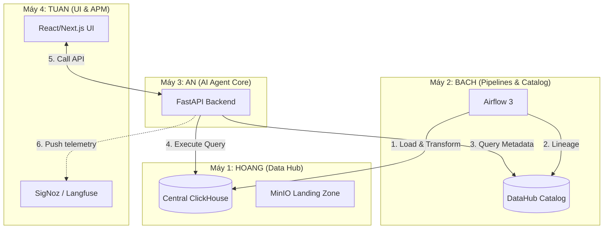

# Hướng dẫn Phân bổ Tài nguyên trên 4 Máy Local (Distributed Local Stack)

Nếu việc host toàn bộ hệ thống trên một VPS gặp khó khăn hoặc cả nhóm muốn chạy thử nghiệm phân tán dưới dạng mạng nội bộ (Collaborative Development), hệ thống có thể được tách nhỏ và phân bổ đều lên máy tính cá nhân của 4 lập trình viên (AN, BACH, HOANG, TUAN).

Tài liệu này hướng dẫn cách phân chia dịch vụ và kết nối mạng nội bộ giữa 4 máy.

---

## 1. Mô hình Phân bổ Dịch vụ (Service Distribution)

Cả nhóm sẽ thống nhất kết nối chung một mạng ảo VPN (như Tailscale hoặc ZeroTier) để các máy local có thể gọi qua lại lẫn nhau qua địa chỉ IP mạng ảo hoặc hostname.



### Chi tiết phân bổ cho từng thành viên:

| Lập trình viên | Vai trò hệ thống | Các dịch vụ khởi chạy | Tài nguyên ước tính |
| :--- | :--- | :--- | :--- |
| **Máy 1: HOANG** | **Storage Hub** (Kho lưu trữ dữ liệu trung tâm) | ClickHouse Central DWH (cổng `18123`/`19000`), MinIO Landing Zone (cổng `19001`/`19002`). | ~2.0 GB RAM |
| **Máy 2: BACH** | **Catalog & Orchestrator** (Điều phối & Siêu dữ liệu) | Apache Airflow 3 (Astro CLI), DataHub (GMS, Frontend, Kafka, Elasticsearch). | ~5.0 GB RAM |
| **Máy 3: AN** | **Agent Engine** (Bộ não AI) | FastAPI Backend (Observation Service), OpenAI/LLM runtime client. | ~1.0 GB RAM |
| **Máy 4: TUAN** | **User Interface & APM** (Giao diện & Giám sát) | React/Next.js Web Server, SigNoz APM, Langfuse v3. | ~4.0 GB RAM |

---

## 2. Cách thiết lập kết nối Mạng nội bộ (Tailscale VPN)

Để 4 máy tính cá nhân ở các địa điểm khác nhau có thể giao tiếp như đang cắm chung một switch mạng:

1.  **Cài đặt Tailscale:** Cả 4 thành viên tải và cài đặt [Tailscale](https://tailscale.com/) trên máy tính của mình.
2.  **Tham gia chung mạng:** Cả 4 máy đăng nhập cùng một tài khoản Tailscale (hoặc share node).
3.  **Lấy IP Tailscale:** Mỗi máy sẽ nhận được một địa chỉ IP nội bộ Tailscale (ví dụ: `100.x.y.z`).
4.  **Cấu hình file `.env` kết nối chéo:**
    *   **Máy AN (Agent Core)** sẽ trỏ cấu hình Clickhouse và Datahub về IP của máy HOANG và máy BACH:
        ```ini
        # Kết nối tới kho ClickHouse trên máy HOANG
        AGENTIC_CLICKHOUSE_HOST=100.80.90.100  # IP Tailscale máy HOANG
        AGENTIC_CLICKHOUSE_PORT=18123
        
        # Kết nối tới DataHub trên máy BACH
        DATAHUB_GMS_HOST=100.80.90.101         # IP Tailscale máy BACH
        DATAHUB_GMS_PORT=28080
        ```
    *   **Máy BACH (Airflow)** cấu hình connection trỏ dbt về máy HOANG:
        ```yaml
        # profiles.yml trên máy BACH
        outputs:
          dev:
            host: 100.80.90.100 # IP Tailscale máy HOANG
            port: 9000
        ```

---

## 3. Ưu nhược điểm của phương án phân tán (Pros & Cons)

### Ưu điểm:
*   **Không tốn tiền nâng cấp VPS:** Tận dụng tối đa RAM của cả 4 máy local (ví dụ mỗi người đóng góp 2-5GB RAM là đủ chạy mượt mà cả hệ thống cực nặng).
*   **Tách biệt trách nhiệm (Separation of Concerns):** Mỗi kỹ sư tập trung quản lý và phát triển dịch vụ của riêng mình, giảm thiểu conflict code và hạ tầng.

### Nhược điểm:
*   **Phụ thuộc lẫn nhau (Dependency):** Khi chạy tích hợp end-to-end, cả 4 máy phải cùng online và kết nối mạng. Nếu máy của HOANG (Clickhouse) tắt, các máy khác sẽ bị ngắt kết nối.
*   **Trễ mạng (Network Latency):** Truy vấn qua VPN mạng ảo sẽ chậm hơn một chút so với chạy tất cả trong cùng localhost hoặc chung VPS.
