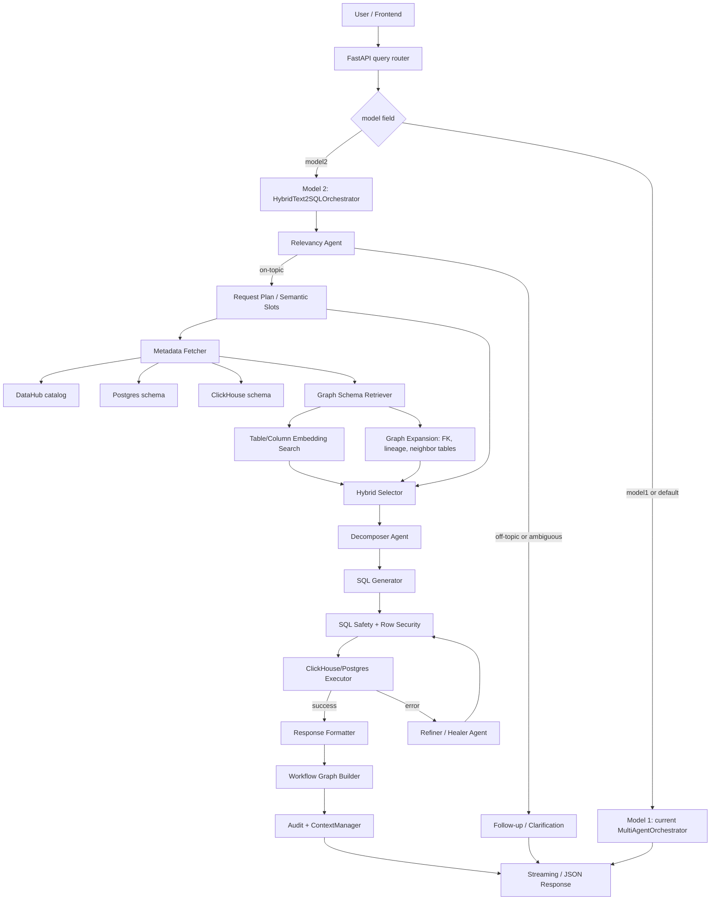
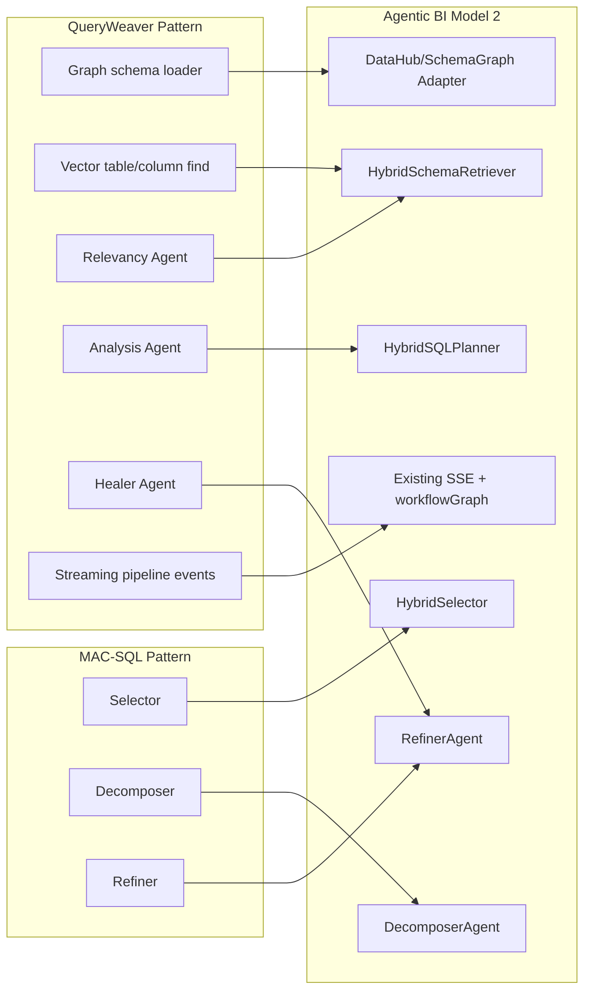

# Agentic BI Model 2 — Hybrid MAC-SQL + QueryWeaver Architecture Plan

## Mục Tiêu

Tài liệu này là plan triển khai **Model 2** cho Agentic BI bằng cách kết hợp kiến trúc của:

- **MAC-SQL**: multi-agent Text-to-SQL research pipeline gồm `Selector -> Decomposer -> Refiner`.
- **QueryWeaver**: production Text2SQL system gồm REST/SDK pipeline, graph-powered schema retrieval, streaming events, SQL healing, confirmation guardrail.
- **Agentic BI hiện tại**: FastAPI Observation Service, DataHub metadata, ClickHouse/Postgres connectors, `MultiAgentOrchestrator`, `MonitoringAgent`, `TableSelector`, SQL safety, row security, workflow graph UI.

Toàn bộ kiến trúc hiện tại được giữ là **Model 1**. Model 2 là pipeline mới chạy song song, có thể bật bằng request field hoặc feature flag để so sánh chất lượng trước khi thay thế.

## Trạng Thái Implementation Trong Repo

Đã implement Model 2 MVP dưới namespace riêng `src/backend/app/agents/model2/` và nối vào API/UI theo cơ chế opt-in:

- Backend route `POST /api/query/chat` và `POST /api/query/chat/stream` nhận `model = "model1" | "model2"`.
- `model1` vẫn là default và tiếp tục dùng `MultiAgentOrchestrator` hiện tại.
- `model2` chạy `HybridText2SQLOrchestrator` gồm relevancy gate, schema retrieval, hybrid selector, decomposer, SQL safety, executor, refiner, formatter, workflow graph.
- Frontend BI Chat và Monitoring Chat đã có selector `Model 1` / `Model 2 Hybrid`.
- Audit metadata ghi lại model được dùng cho từng request.
- Unit tests đã cover selector, routing/filtering, workflow graph và API model contract.

Các phần còn là roadmap sau MVP: graph store/cache riêng, lineage expansion đầy đủ từ DataHub/dbt, golden-set comparison tự động giữa Model 1 và Model 2.

## Nguyên Tắc Thiết Kế

1. Không import nguyên repo MAC-SQL hoặc QueryWeaver vào codebase.
2. Giữ nguyên Model 1 để làm baseline ổn định.
3. Model 2 tái sử dụng connector, auth, context, audit, row-security, SQL safety, chart rendering và workflow graph hiện có.
4. Chỉ thêm các agent/pipeline còn thiếu: graph retrieval adapter, MAC-style selector, decomposer, refiner/healer, formatter contract.
5. Mọi output của Model 2 phải giữ shape tương thích với frontend hiện tại: `answer`, `rows`, `rowCount`, `chartSpec`, `sql`, `selectedTables`, `attempts`, `workflowGraph`, `llmUsage`.

## Snapshot Kiến Trúc Hiện Tại: Model 1

Model 1 đang nằm trong các module chính:

```text
src/backend/app/routers/query.py
  -> MultiAgentOrchestrator.answer()
    -> build_request_plan()
    -> agent_plan
    -> specialist agents
      -> MonitoringAgent.answer()
        -> DataHub/Postgres schema fetch
        -> TableSelector.select()
        -> LlmService.generate_sql()
        -> validate_readonly_sql()
        -> apply_row_security()
        -> ClickHouse/Postgres execute
        -> LlmService.correct_sql()
        -> infer_chart_spec()
        -> LlmService.synthesize()
    -> SummarizerAgent
    -> build_workflow_graph()
```

Model 1 cần giữ nguyên contract API:

```text
POST /api/query/chat
POST /api/query/chat/stream
GET  /api/query/schema
POST /api/query/dashboard
```

## Model 2 Tổng Quan

Model 2 sẽ là một pipeline Text2SQL hybrid bên cạnh Model 1:

```text
User question
  -> Relevancy gate
  -> Existing semantic slots
  -> Metadata catalog fetch
  -> QueryWeaver-style graph retrieval
  -> MAC-SQL-style selector/pruner
  -> MAC-SQL-style decomposer
  -> SQL validation and row security
  -> DB execution
  -> MAC-SQL/QueryWeaver-style refiner/healer
  -> BI response formatter
  -> workflowGraph + audit + context persistence
```

### Sơ Đồ Kiến Trúc Model 2



### Sơ Đồ Mapping MAC-SQL + QueryWeaver Vào Agentic BI



## Đề Xuất Cấu Trúc File

Không thay thế `MonitoringAgent` ngay. Thêm Model 2 dưới namespace riêng:

```text
src/backend/app/agents/model2/
  __init__.py
  orchestrator.py              # HybridText2SQLOrchestrator
  contracts.py                 # dataclass/Pydantic-like dict contracts
  relevancy_agent.py           # QueryWeaver-style relevancy gate
  schema_retriever.py          # DataHub + optional graph/vector retrieval
  hybrid_selector.py           # MAC-SQL Selector adapted to Agentic BI metadata
  decomposer_agent.py          # MAC-SQL Decomposer adapted to BI questions
  sql_planner.py               # structured SQL generation wrapper
  refiner_agent.py             # MAC-SQL Refiner + QueryWeaver Healer pattern
  response_formatter.py        # BI answer + chart explanation
  workflow_graph.py            # Model 2 graph builder or extension adapter

src/backend/app/services/
  llm.py                       # extend with model2 prompt methods

src/backend/app/routers/
  query.py                     # add model selector, keep old routes compatible

src/frontend/src/components/Dashboard/
  AgentFlowGraph.tsx           # already supports workflowGraph nodes
```

Nếu muốn graph store thật theo QueryWeaver ở phase sau:

```text
src/backend/app/metadata_graph/
  __init__.py
  schema_graph.py              # normalized in-memory/Postgres graph model
  embeddings.py                # table/column embedding cache
  lineage_edges.py             # DataHub lineage -> graph edges
```

Phase đầu có thể chưa cần database graph mới. Dùng DataHub tables + existing `TableSelector` làm candidate retrieval trước, rồi bọc thành graph-shaped contract.

## API Contract

Mở rộng `ChatRequest` trong `src/backend/app/routers/query.py`:

```python
class ChatRequest(BaseModel):
    question: str = Field(min_length=1, max_length=2000)
    target: str = "auto"
    model: str = "model1"  # model1 | model2
    limit: int = Field(default=100, ge=1, le=500)
    conversation: list[dict[str, Any]] = Field(default_factory=list)
    windowHours: int | None = None
    includeSynthesis: bool = True
    sessionId: str | None = Field(default=None, max_length=64)
```

Router dispatch:

```text
if payload.model == "model2":
    result = await model2_orchestrator.answer(...)
else:
    result = await orchestrator.answer(...)
```

Giữ response top-level tương thích:

```json
{
  "agent": "model2_hybrid_text2sql",
  "model": "model2",
  "status": "success",
  "answer": "...",
  "rows": [],
  "rowCount": 0,
  "chartSpec": {"type": "table"},
  "sql": "SELECT ...",
  "selectedTables": ["vsf_mart.fct_llm_interactions"],
  "attempts": [],
  "workflowGraph": {"nodes": [], "edges": []},
  "metadataContext": {},
  "tableSelection": {},
  "sqlGeneration": {},
  "llmUsage": {},
  "executionTimeMs": 1234
}
```

## Streaming Event Contract

Model 2 nên emit stage events tương thích `_stream_chat_events()` hiện tại:

```json
{"type": "stage", "stage": "model2.relevancy", "message": "Checking if the question is answerable from BI metadata"}
{"type": "stage", "stage": "model2.graph_retrieval", "message": "Finding related tables, columns, lineage, and joins"}
{"type": "stage", "stage": "model2.selector", "message": "Pruning schema with MAC-SQL selector"}
{"type": "stage", "stage": "model2.decomposer", "message": "Decomposing the BI question into SQL steps"}
{"type": "stage", "stage": "model2.executor", "message": "Executing validated read-only SQL"}
{"type": "stage", "stage": "model2.refiner", "message": "Repairing SQL from database error"}
{"type": "stage", "stage": "model2.formatter", "message": "Formatting answer and visualization"}
```

Frontend `AgentFlowGraph.tsx` đã ưu tiên `workflowGraph.nodes`. Vì vậy Model 2 chỉ cần trả `workflowGraph` giàu node hơn.

## Model 2 Agent Contracts

### 1. Relevancy Agent

Nguồn cảm hứng: QueryWeaver `RelevancyAgent`.

Nhiệm vụ:

- Chặn câu hỏi không liên quan dữ liệu.
- Phát hiện câu hỏi thiếu domain/metric/time range.
- Không sinh SQL khi câu hỏi cần clarification.

Input:

```json
{
  "question": "...",
  "requestPlan": {},
  "memory": {},
  "availableDomains": ["observability", "llm_usage", "ingestion", "agent_cost"]
}
```

Output:

```json
{
  "status": "on_topic",
  "reason": "",
  "needsClarification": false,
  "clarification": null
}
```

Implementation:

- Phase 1 dùng rule-based + existing `clarification_for(request_plan)`.
- Phase 2 thêm `LlmService.model2_relevancy()` nếu LLM configured.

### 2. Schema Retriever

Nguồn cảm hứng: QueryWeaver graph-powered schema understanding.

Nhiệm vụ:

- Lấy metadata từ DataHub/Postgres/ClickHouse như Model 1.
- Chuẩn hóa thành graph-like schema context.
- Tìm candidate table/column bằng keyword + embedding.
- Thêm lineage/FK/join-neighbor tables nếu có.

Không nên thay DataHub bằng FalkorDB ngay. Agentic BI đã có DataHub là metadata store chính. Phase đầu dùng DataHub như authoritative catalog.

Contract:

```json
{
  "databaseDescription": "Agentic BI analytics warehouse",
  "tables": [
    {
      "tableName": "vsf_mart.fct_llm_interactions",
      "database": "vsf_mart",
      "description": "...",
      "columns": [{"name": "metric_date", "type": "Date"}],
      "foreignKeys": [],
      "lineage": [],
      "sampleValues": {}
    }
  ],
  "edges": [
    {"from": "vsf_stg.staging_llm_generations", "to": "vsf_mart.fct_llm_interactions", "type": "LINEAGE"}
  ],
  "retrieval": {
    "strategy": "datahub_keyword_embedding_graph_expansion",
    "candidateCount": 5
  }
}
```

Mapping với QueryWeaver:

- QueryWeaver `Database` node -> Agentic BI datasource/catalog description.
- QueryWeaver `Table` node -> DataHub/ClickHouse table metadata.
- QueryWeaver `Column` node -> existing `columns`.
- QueryWeaver `REFERENCES` edge -> FK/lineage edges from DataHub/dbt metadata.
- QueryWeaver vector index -> existing `TableSelector._rank_with_embeddings()`.

### 3. Hybrid Selector

Nguồn cảm hứng: MAC-SQL `Selector`.

Nhiệm vụ:

- Nhận candidate schema từ Schema Retriever.
- Prune table/column theo câu hỏi, evidence, slots.
- Luôn giữ key/time/metric columns quan trọng.
- Không đưa full schema quá rộng vào prompt SQL.

Contract:

```json
{
  "selectedTables": [
    {
      "tableName": "vsf_mart.fct_llm_interactions",
      "decision": "keep_all",
      "selectedColumns": ["metric_date", "model", "total_tokens", "cost_usd"],
      "reason": "matches llm_usage cost over time"
    }
  ],
  "foreignKeys": [],
  "lineageEdges": [],
  "schemaPrompt": "... compact schema string ...",
  "confidence": 0.84,
  "strategy": "macsql_selector_over_datahub_candidates"
}
```

Rules từ MAC-SQL cần giữ:

- Table nhỏ hoặc rất liên quan: `keep_all`.
- Table không liên quan: `drop_all`.
- Table lớn: chọn top columns theo relevance.
- Ưu tiên PK/FK/time/metric/dimension columns.
- Giữ ít nhất 2 table nếu query cần join/lineage/root-cause.

### 4. Decomposer Agent

Nguồn cảm hứng: MAC-SQL `Decomposer`.

Nhiệm vụ:

- Với câu hỏi BI phức tạp, tách thành các sub-question.
- Sinh plan có thể kiểm tra được.
- Không để reasoning tự do tràn vào final answer; lưu trong `sqlGeneration`.

Output:

```json
{
  "subQuestions": [
    {
      "id": "sq1",
      "question": "Filter interactions in the last 7 days",
      "sqlFragment": "WHERE metric_date >= today() - 7"
    },
    {
      "id": "sq2",
      "question": "Aggregate cost by model",
      "sqlFragment": "GROUP BY model"
    }
  ],
  "sql": "SELECT ...",
  "selectedTables": ["vsf_mart.fct_llm_interactions"],
  "visualization": {"type": "bar", "x": "model", "y": "cost_usd"},
  "confidence": 0.82
}
```

Implementation:

- Có thể extend `LlmService.generate_sql()` thành `LlmService.model2_decompose_and_generate_sql()`.
- Prompt phải dùng JSON-only giống QueryWeaver `AnalysisAgent`.
- Dialect vẫn lấy từ datasource: ClickHouse hoặc PostgreSQL.

### 5. SQL Safety + Row Security

Tái sử dụng code hiện có:

- `validate_readonly_sql()` trong `src/backend/app/agents/sql_safety.py`
- `apply_row_security()` trong `src/backend/app/agents/row_security.py`

Model 2 vẫn là BI read-only pipeline. Không bật destructive confirmation như QueryWeaver ở phase đầu, vì Agentic BI hiện tại có chính sách read-only. Nếu sau này cần writeback, thêm confirmation riêng.

### 6. Executor

Tái sử dụng connectors hiện có:

- ClickHouse: `src/backend/app/connectors/clickhouse.py`
- Postgres DWH/ops: `src/backend/app/connectors/postgres.py`

Không tạo loader kiểu QueryWeaver để connect DB tùy ý trong phase đầu. Agentic BI có datasource cố định và governed metadata.

### 7. Refiner / Healer Agent

Nguồn cảm hứng:

- MAC-SQL `Refiner`: execute SQL, nếu lỗi thì prompt sửa SQL.
- QueryWeaver `HealerAgent`: retry bounded, dùng DB error + schema.

Contract attempt:

```json
{
  "attempt": 1,
  "sql": "SELECT ...",
  "status": "failed",
  "error": "Missing columns: total_cost",
  "repairSource": "model2_refiner",
  "fixedSql": "SELECT sum(cost_usd) AS total_cost ..."
}
```

Policy:

- Max retry dùng `settings.agent_retry_count`, hiện default là 2.
- Không sửa query thành DML/DDL.
- Sau mỗi repair phải chạy lại `validate_readonly_sql()` và `apply_row_security()`.
- Nếu vẫn lỗi, trả `status = "error"` nhưng giữ attempts để UI debug được.

### 8. Response Formatter

Nguồn cảm hứng: QueryWeaver `ResponseFormatterAgent`, nhưng phải phù hợp Agentic BI.

Tái sử dụng:

- `LlmService.synthesize()`
- `infer_chart_spec()`
- `SummarizerAgent` nếu Model 2 chạy trong multi-agent mode.

Formatter output:

```json
{
  "answer": "Trong 7 ngày gần nhất, model X chiếm chi phí cao nhất...",
  "chartSpec": {"type": "bar", "x": "model", "y": "cost_usd"},
  "warnings": [],
  "llmSynthesis": {}
}
```

## Workflow Graph Model 2

Thêm builder riêng hoặc mở rộng `src/backend/app/agents/workflow_graph.py`.

Node đề xuất:

```json
[
  {"id": "user", "label": "User", "kind": "person"},
  {"id": "model_router", "label": "Model Router", "kind": "planner"},
  {"id": "model2_relevancy", "label": "Relevancy Agent", "kind": "guardrail"},
  {"id": "semantic_slots", "label": "Semantic Slots", "kind": "planner"},
  {"id": "metadata_catalog", "label": "DataHub Metadata", "kind": "datahub"},
  {"id": "graph_retrieval", "label": "Graph Schema Retrieval", "kind": "retriever"},
  {"id": "hybrid_selector", "label": "Hybrid Selector", "kind": "selector"},
  {"id": "decomposer", "label": "Decomposer Agent", "kind": "agent"},
  {"id": "sql_safety", "label": "SQL Safety", "kind": "guardrail"},
  {"id": "executor", "label": "ClickHouse/Postgres Executor", "kind": "database"},
  {"id": "refiner", "label": "Refiner Agent", "kind": "agent"},
  {"id": "formatter", "label": "Response Formatter", "kind": "agent"},
  {"id": "response", "label": "Response", "kind": "result"}
]
```

Sơ đồ workflow:

```mermaid
flowchart LR
    user[User] --> router[Model Router]
    router --> relevancy[Relevancy Agent]
    relevancy --> slots[Semantic Slots]
    slots --> catalog[DataHub Metadata]
    catalog --> graph[Graph Retrieval]
    graph --> selector[Hybrid Selector]
    selector --> decomposer[Decomposer]
    decomposer --> safety[SQL Safety]
    safety --> executor[Executor]
    executor -->|error| refiner[Refiner]
    refiner --> safety
    executor -->|success| formatter[Formatter]
    formatter --> response[Response]
```

## Prompt Boundaries

Model 2 prompts phải theo thứ tự authority:

1. System safety rules.
2. Actual schema from DataHub/Postgres/ClickHouse.
3. Row security / datasource policy.
4. User question.
5. Conversation memory.

Không cho memory override schema. Đây là điểm QueryWeaver làm rất tốt trong `AnalysisAgent`.

SQL generation JSON nên bắt buộc:

```json
{
  "is_sql_translatable": true,
  "query_analysis": "...",
  "sub_questions": [],
  "sql": "...",
  "selected_tables": [],
  "missing_information": [],
  "ambiguities": [],
  "confidence": 0.0,
  "visualization": {}
}
```

## Phase Implementation Plan

### Phase 0 — Documentation And Toggle

- Thêm `model` vào `ChatRequest`.
- Default `model = "model1"` để không phá UI/API cũ.
- Log/audit thêm `model` trong metadata.
- Frontend thêm dropdown hoặc segmented control:
  - `Model 1: Current`
  - `Model 2: Hybrid`

### Phase 1 — Model 2 MVP Không Graph Store Mới

Implement:

```text
model2/orchestrator.py
model2/relevancy_agent.py
model2/schema_retriever.py
model2/hybrid_selector.py
model2/decomposer_agent.py
model2/refiner_agent.py
model2/response_formatter.py
```

MVP flow:

```text
DataHub/Postgres metadata
  -> existing TableSelector candidates
  -> MAC-style HybridSelector prune
  -> Decomposer/SQL planner
  -> existing safety/security/executor
  -> existing correction fallback + model2 refiner attempts
```

Không cần graph DB mới ở phase này.

### Phase 2 — QueryWeaver-Style Graph Retrieval Adapter

Implement graph-shaped retrieval nhưng lưu in-memory/cache:

- Convert table metadata thành nodes/edges.
- Tạo table/column document strings.
- Reuse OpenAI embeddings path hiện có trong `TableSelector`.
- Thêm lineage edges từ DataHub nếu connector expose được.

Output graph context dùng cho selector/decomposer.

### Phase 3 — Refiner Hardening

- Chuẩn hóa attempts.
- Thêm retry policy.
- Phân loại lỗi:
  - missing column/table
  - wrong dialect
  - aggregation/group by
  - type mismatch
  - timeout
- Với timeout, không retry quá rộng; giảm limit hoặc yêu cầu user narrow scope.

### Phase 4 — UI Workflow Graph

- `workflowGraph` của Model 2 trả node rõ theo stage.
- `AgentFlowGraph.tsx` đã render theo `workflowGraph.nodes`, chỉ cần đảm bảo `kind`, `label`, `status` dễ đọc.
- Thêm hiển thị `model` trong panel kết quả.

### Phase 5 — Evaluation

Dùng `tests/golden_set.json` hoặc tạo file riêng:

```text
tests/model2_golden_set.json
tests/run_model_comparison.py
```

Metrics:

- execution success rate
- answer correctness manual score
- SQL validity
- retry count
- selected table precision
- latency
- token usage
- row count sanity
- chart type correctness

So sánh:

```text
question -> Model 1 result
question -> Model 2 result
diff SQL/result/status/tokens/latency
```

## Acceptance Criteria

Model 2 được coi là usable khi:

- Chạy qua `/api/query/chat` và `/api/query/chat/stream` với `model = "model2"`.
- Không ảnh hưởng request mặc định Model 1.
- Trả response shape tương thích frontend.
- Có workflow graph hiển thị đủ các stage Model 2.
- Sinh SQL read-only và qua row security.
- Tự sửa ít nhất một lỗi SQL phổ biến bằng refiner loop.
- Chạy được tối thiểu 10 câu hỏi golden set hiện có.

## Rủi Ro Và Cách Giảm

| Rủi ro | Cách giảm |
|---|---|
| Prompt quá lớn | QueryWeaver retrieval trước, MAC selector prune sau |
| Model 2 chậm hơn Model 1 | Cache metadata, cache embeddings, bounded retries |
| Hallucinate column/table | Validate SQL against selected schema trước execute |
| Sai datasource | Reuse existing `build_request_plan()` và `_route_datasource()` logic |
| UI không render flow mới | Luôn trả `workflowGraph.nodes/edges` theo contract hiện tại |
| Phá API cũ | `model` default là `model1`, Model 2 chỉ opt-in |

## Checklist Implement Nhanh

- [x] Add `model = "model1" | "model2"` to `ChatRequest`.
- [x] Instantiate `HybridText2SQLOrchestrator` in `build_router()`.
- [x] Dispatch `run_chat()` and stream path by `payload.model`.
- [x] Create `src/backend/app/agents/model2/contracts.py`.
- [x] Create `schema_retriever.py` using DataHub/Postgres/ClickHouse metadata.
- [x] Create `hybrid_selector.py` with MAC-SQL keep/drop/select-column decisions.
- [x] Reuse existing `LlmService.generate_sql()` with Model 2 schema prompt and selector contract.
- [x] Create `refiner_agent.py` using failed SQL + DB error + selected schema.
- [x] Reuse `_prepare_sql_candidate()` so every attempt gets read-only validation and row security.
- [x] Return Model 2 `workflowGraph`.
- [x] Add frontend model selector.
- [x] Add Model 2 contract/unit tests.
- [x] Add automated golden-set comparison script between Model 1 and Model 2 (`tests/run_model_comparison.py`).
- [ ] Add persistent graph/embedding cache if Model 2 becomes the default.

## Implementation Note

Model 2 should be built as a productionized version of MAC-SQL, not as a research script:

- MAC-SQL contributes the cognitive workflow: selector, decomposer, refiner.
- QueryWeaver contributes retrieval and pipeline discipline: graph context, relevancy, structured JSON, healing, streaming.
- Agentic BI contributes runtime ownership: governed metadata, ClickHouse/Postgres execution, auth, audit, row security, chart/dashboard output.

This keeps Model 1 stable while giving Model 2 a clean path to become the stronger default once evaluation proves it.
