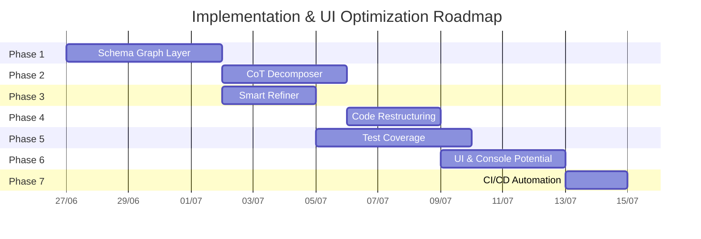

# Kế Hoạch Cải Tiến Kiến Trúc & UI `dev-agent`

> Mục tiêu: Nâng cấp toàn diện kiến trúc backend từ **6.2/10** lên **8.5/10**, đồng thời lột xác giao diện UI/UX theo hướng cao cấp (Premium/Glassmorphism) cho các bảng điều khiển AI/BI và tự động hóa luồng triển khai (Git push & Docker rebuild).

## Tổng Quan Phases



| Phase | Ưu tiên | Ước tính | Files mới | Files sửa |
|---|---|---|---|---|
| 1. Schema Graph Layer | 🔴 Critical | 5 ngày | 4 | 2 |
| 2. CoT Decomposer | 🔴 Critical | 4 ngày | 2 | 2 |
| 3. Smart Refiner | 🟡 High | 3 ngày | 2 | 1 |
| 4. Code Restructuring | 🟡 High | 3 ngày | 7 | 1 |
| 5. Test Coverage | 🔴 Critical | 5 ngày | 8 | 0 |
| 6. UI & Console Potential | 🔴 Critical | 4 ngày | 1 | 4 |
| 7. CI/CD Automation | 🔴 Critical | 2 ngày | 1 | 1 |

---

## Phase 1: Schema Graph Layer 🔴

> Mục tiêu: Thay thế fake graph (shared columns) bằng in-memory schema graph thực sự, lấy cảm hứng từ FalkorDB knowledge graph của QueryWeaver.

### Tại sao cần thiết

Hiện tại `_graph_edges()` trong `schema_retriever.py` chỉ tìm shared column names giữa các tables **đã được select**. Điều này có 2 vấn đề:
1. Không tìm được join path qua bridge tables (table C nối A và B nhưng không được select)
2. Chicken-and-egg: graph chỉ build SAU khi select → không dùng graph ĐỂ select

### Proposed Changes

#### [NEW] `agents/model2/schema_graph.py`

**In-memory directed graph** build từ DataHub metadata khi startup:

```python
class SchemaGraph:
    """In-memory schema relationship graph.
    
    Nodes = tables, Edges = relationships (FK, shared columns, lineage).
    Built once from DataHub metadata, refreshed on cache expiry.
    """
    
    def __init__(self) -> None:
        self._nodes: dict[str, TableNode] = {}      # table_name → node
        self._edges: list[SchemaEdge] = []           # all edges
        self._adjacency: dict[str, list[SchemaEdge]] = {}  # table → outgoing edges
    
    def build_from_metadata(self, tables: list[dict], lineage: list[dict] | None = None) -> None:
        """Build graph from DataHub table metadata + optional lineage."""
        # 1. Add all tables as nodes
        # 2. Detect FK edges: column_name ends with _id AND exists in another table
        # 3. Detect shared-column edges: same column name in multiple tables
        # 4. Add lineage edges if available (DataHub lineage API)
        # 5. Compute edge weights based on relationship type
    
    def find_join_paths(
        self, 
        source_tables: list[str], 
        *, 
        max_hops: int = 2,
    ) -> list[JoinPath]:
        """BFS/DFS to find join paths between selected tables, including bridge tables."""
    
    def expand_with_bridges(
        self, 
        selected_tables: list[str],
        question: str,
    ) -> list[str]:
        """Given selected tables, find and add necessary bridge tables."""
    
    def subgraph(self, table_names: list[str]) -> "SchemaGraph":
        """Extract subgraph containing only the given tables + connecting edges."""
```

#### [NEW] `agents/model2/graph_retriever.py`

**Graph-aware schema retrieval** — thay thế logic hiện tại trong `schema_retriever.py`:

```python
class GraphSchemaRetriever:
    """Uses SchemaGraph to enhance table retrieval with join path awareness."""
    
    async def retrieve(self, question, *, target, request_plan, schema_graph):
        # Step 1: Get initial candidates from existing BM25 retrieval
        initial = await self._keyword_retrieval(question, target, request_plan)
        
        # Step 2: Graph expansion - find bridge tables
        expanded_names = schema_graph.expand_with_bridges(
            [t["tableName"] for t in initial.tables],
            question,
        )
        expanded_tables = self._resolve_tables(expanded_names)
        
        # Step 3: Graph-weighted re-ranking
        graph_edges = schema_graph.subgraph(expanded_names)
        reranked = self._graph_rerank(expanded_tables, graph_edges, question)
        
        # Step 4: Find join paths for SQL planner context
        join_paths = schema_graph.find_join_paths(
            [t["tableName"] for t in reranked]
        )
        
        return SchemaRetrievalResult(
            ...,
            graph_edges=graph_edges.to_edge_list(),
            join_paths=[path.to_dict() for path in join_paths],
        )
```

#### [MODIFY] `agents/model2/schema_retriever.py`
- Import và sử dụng `SchemaGraph` thay vì hàm `_graph_edges()` inline
- Thêm `join_paths` vào `SchemaRetrievalResult`
- Gọi `schema_graph.expand_with_bridges()` trước khi trả về

#### [MODIFY] `agents/model2/contracts.py`
Thêm `join_paths` field vào `SchemaRetrievalResult`.

#### [MODIFY] `agents/model2/orchestrator.py`
- Init `SchemaGraph` trong `__init__` (lazy build)
- Truyền `schema_graph` vào `schema_retriever.retrieve()`
- Truyền `join_paths` vào `decomposer.plan()` để SQL planner biết join cách nào

#### [NEW] `connectors/datahub_lineage.py`
Fetch lineage data từ DataHub GraphQL API.

---

## Phase 2: Chain-of-Thought Decomposer 🔴

> Mục tiêu: Thay thế stub `_deterministic_sub_questions()` bằng multi-step reasoning thực sự cho complex queries.

### Proposed Changes

#### [MODIFY] `agents/model2/decomposer_agent.py`
Redesign thành 2-tier system (kiểm tra độ phức tạp trước khi chia nhỏ câu hỏi).

#### [NEW] `agents/model2/complexity_assessor.py`
Phân loại complexity để quyết định cần decompose hay không (dựa trên số bảng join, từ khóa so sánh thời gian, ranking).

#### [MODIFY] `agents/model2/contracts.py`
Thêm fields cho `DecompositionPlan`.

#### [NEW] `services/llm_prompts.py`
Prompt templates tách riêng quản lý phiên bản.

---

## Phase 3: Smart Refiner 🟡

> Mục tiêu: Biến `refiner_agent.py` thành error-aware SQL repair system.

### Proposed Changes

#### [MODIFY] `agents/model2/refiner_agent.py`
Bổ sung logic phân loại lỗi và truyền context tích lũy qua các vòng lặp retry.

#### [NEW] `agents/model2/error_classifier.py`
Phân loại lỗi từ Database (sai cột, sai cú pháp, sai kiểu dữ liệu) và gợi ý sửa nhanh bằng fuzzy match.

#### [MODIFY] `agents/model2/orchestrator.py`
Truyền accumulative error context qua retry loop trong `_refine_until_success()`.

---

## Phase 4: Code Restructuring 🟡

> Mục tiêu: Tách `multi_agent.py` (2836 dòng) thành các modules chuyên biệt.

### Proposed Changes

#### [NEW] `agents/specialists/` directory
Tách từng specialist agent ra file riêng (`chart_agent.py`, `insight_agent.py`, `forecast_agent.py`, `qa_agent.py`, `summarizer_agent.py`).

#### [MODIFY] `agents/multi_agent.py`
Giảm xuống ~500 dòng chỉ chứa `MultiAgentOrchestrator` + imports.

---

## Phase 5: Test Coverage 🔴

> Mục tiêu: Từ **647 dòng test** → **~3000 dòng**, đạt **≥70% coverage**.

### Proposed Test Files
- `tests/test_schema_graph.py`
- `tests/test_decomposer.py`
- `tests/test_refiner.py`
- `tests/test_complexity_assessor.py`
- `tests/test_relevancy_agent.py`
- `tests/test_context_manager.py`
- `tests/test_insight_agent.py`
- `tests/test_orchestrator_integration.py`

---

## Phase 6: UI & Console Potential (Cải thiện UI & Khai thác toàn bộ tiềm năng) 🔴

> Mục tiêu: Nâng cấp giao diện theo phong cách Premium/Glassmorphism hiện đại, tối ưu hóa trải nghiệm người dùng và bổ sung các tính năng nâng cao nhằm khai thác trọn vẹn sức mạnh của 3 bảng điều khiển chính.

### Proposed Changes

#### [MODIFY] `src/frontend/src/styles/app.css`
- **Premium Aesthetics:** Bổ sung hệ thống biến màu HSL hiện đại (Dark mode chủ đạo với tông than chì `#121316`, viền glow mờ `#2a2b30` và các điểm nhấn neon cam/tím sang trọng).
- **Glassmorphism:** Sử dụng thuộc tính `backdrop-filter: blur(12px)` cho các bảng điều khiển, modal và thẻ thông tin, tạo chiều sâu thị giác.
- **Micro-animations:** Thêm hiệu ứng hover mượt mà (`transition: all 0.25s ease-in-out`), hiệu ứng gợn sóng khi bấm nút và skeleton loading động cho các biểu đồ.

#### [MODIFY] `src/frontend/src/components/Dashboard/QueryConsolePanel.tsx`
- **UI Improvements:** 
  - Nâng cấp bảng kết quả (`ResultTable`): bổ sung tính năng Pagination (phân trang) tại frontend, cho phép tìm kiếm nhanh (instant filter) và bấm vào tiêu đề cột để sắp xếp (sorting).
  - Khung **ClarificationPanel**: Thiết kế lại thành dạng modal/thẻ pop-up trực quan, các lựa chọn được trình bày dưới dạng nút bấm lớn kèm mô tả chi tiết thay vì các nút thứ cấp đơn điệu.
- **Khai thác tiềm năng:**
  - **AI vs SQL Comparison:** Thêm tính năng đối chiếu song song giữa câu SQL do AI sinh ra và câu SQL thủ công của người dùng để so sánh hiệu năng và chi phí.
  - **Smart Chart Recommendation:** Nút "Auto-Optimize Chart", tự động đề xuất loại biểu đồ phù hợp nhất dựa trên kiểu dữ liệu trả về (ví dụ: chuỗi thời gian -> Line chart, tỷ trọng -> Pie chart).

#### [MODIFY] `src/frontend/src/components/Dashboard/GeneratedDashboardPanel.tsx`
- **UI Improvements:**
  - Lưới Dashboard (Grid) tương tác cao: Cho phép người dùng bấm nút mở rộng toàn màn hình (fullscreen expand) cho từng panel riêng biệt.
  - Hộp thoại tạo Dashboard: Thêm hiệu ứng shimmer loading đẹp mắt khi AI đang phân tích và thực thi đồng thời các panel.
- **Khai thác tiềm năng:**
  - **Export to Multiple Formats:** Bổ sung chức năng xuất toàn bộ Dashboard ra trang HTML độc lập (kèm dữ liệu nhúng), file PDF hoặc cấu trúc JSON để chia sẻ nhanh.
  - **Push to Metabase:** Thêm nút "Publish to Metabase" trên mỗi panel, gọi API backend để tạo trực tiếp một Question mới trên Metabase từ câu SQL mà AI vừa khởi tạo.

#### [MODIFY] `src/frontend/src/components/Dashboard/MetabasePanel.tsx`
- **UI Improvements:**
  - Tối ưu hóa danh sách Public Dashboards thành dạng lưới thẻ (Interactive Cards) với viền gradient glow khi hover, hiển thị rõ mô tả và trạng thái kết nối.
  - Giao diện iframe tích hợp thanh điều khiển trên cùng (top bar) cho phép tải lại (refresh), xem gốc hoặc sao chép liên kết nhúng.
- **Khai thác tiềm năng:**
  - **Auto-refresh Timer:** Bổ sung bộ đếm thời gian (ví dụ: tự động tải lại sau mỗi 30s, 1m, 5m) cho các báo cáo realtime lớp Gold.
  - **System Health Indicator:** Hiển thị trực quan trạng thái kết nối tới máy chủ Metabase và ClickHouse gốc.

---

## Phase 7: CI/CD Automation (Tự động hóa Git Push & Rebuild Image) 🔴

> Mục tiêu: Tự động hóa quy trình đẩy code lên nhánh `dev-agent` và xây dựng (rebuild) lại các image Docker cần thiết mỗi khi có thay đổi mã nguồn mà không làm gián đoạn hệ thống.

### Proposed Changes

#### [NEW] `scripts/auto_deploy.sh`
Script bash đa năng chạy trên môi trường Linux/Ubuntu, thực hiện các công việc:
1. Kiểm tra trạng thái thay đổi bằng `git status --porcelain`.
2. Nếu có thay đổi, tự động thực hiện:
   ```bash
   git add .
   git commit -m "auto: update UI and console panels [skip ci]"
   git push origin dev-agent
   ```
3. Khởi động việc build lại image và cập nhật container UI mà không ảnh hưởng đến các service khác:
   ```bash
   docker compose -f docker-compose.agentic-ui.yml build observation-web
   docker compose -f docker-compose.agentic-ui.yml up -d --no-deps observation-web
   ```

#### [MODIFY] `Makefile`
Bổ sung các target tự động hóa vào `Makefile`:

```makefile
.PHONY: deploy-ui watch-ui

deploy-ui:
	@bash scripts/auto_deploy.sh

# Target hỗ trợ tự động theo dõi thay đổi (giám sát thư mục src/frontend và docs)
watch-ui:
	@echo "Watching for file changes to trigger auto-deploy..."
	@while true; do \
		inotifywait -r -e modify,create,delete src/ docs/ scripts/ >/dev/null 2>&1 || sleep 5; \
		make deploy-ui; \
	done
```

---

## Open Questions

> [!IMPORTANT]
> **Q1: Định dạng Export Dashboard?**
> Khi xuất dữ liệu từ `GeneratedDashboardPanel`, bạn muốn ưu tiên xuất ra file HTML tĩnh (chứa sẵn script biểu đồ) hay xuất thẳng file PDF? (Đề xuất: HTML tĩnh vì giữ được tính năng biểu tác động của DynamicChart).

> [!IMPORTANT]
> **Q2: Cơ chế Watch cho Auto Deploy?**
> Bạn muốn chạy script `make deploy-ui` thủ công sau khi hoàn tất cụm tính năng, hay bật chế độ `make watch-ui` (sử dụng inotifywait / polling) để tự động kích hoạt ngay lập tức khi file thay đổi?

## Verification Plan

### Automated Tests
```bash
# Verify UI build
cd src/frontend && npm run build

# Check bash script syntax
bash -n scripts/auto_deploy.sh
```

### Manual Verification
1. **UI Premium Check:** Mở giao diện trên trình duyệt tại `http://localhost:3003`, kiểm tra hiệu ứng blur glassmorphism và giao diện Dark Mode.
2. **Feature Check:** 
   - Thử nghiệm phân trang và filter trên `QueryConsolePanel`.
   - Bấm nút "Publish to Metabase" trên `GeneratedDashboardPanel`.
   - Kiểm tra Auto-refresh timer trên `MetabasePanel`.
3. **Automation Check:** Chạy thử `make deploy-ui`, kiểm tra log xem code đã được push thành công lên nhánh `dev-agent` và container `observation-web` đã được rebuild/restart đúng cách chưa.
